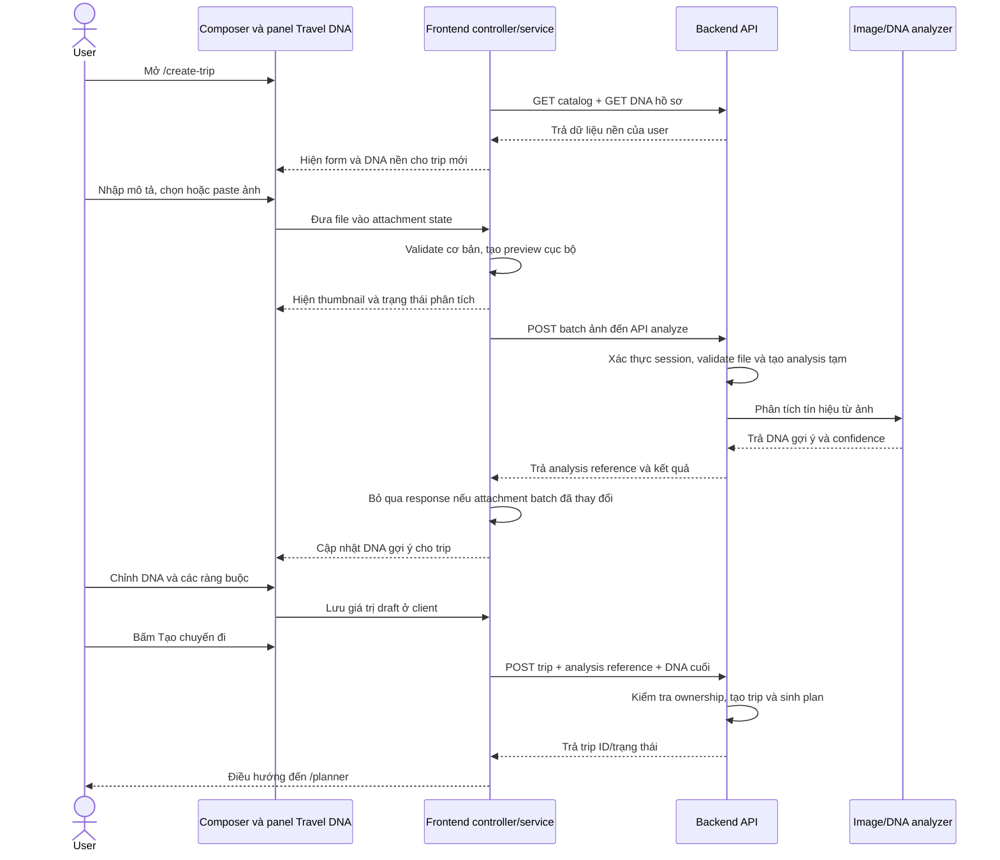

# Báo cáo đề xuất: Đính kèm ảnh và phân tích Travel DNA tại `/create-trip`

- **Ngày:** 2026-10-08
- **Đối tượng:** Frontend và Backend VISTRA
- **Mục tiêu:** Thống nhất luồng người dùng khi nhập yêu cầu/ảnh trong composer, xem gợi ý Travel DNA, chỉnh DNA cho riêng chuyến đi và tạo trip.
- **Trạng thái:** Đề xuất để hai team review. Các contract ghi “đề xuất” chưa phải API đã triển khai.

## 1. Tóm tắt hướng đề xuất

Đưa thao tác chọn/paste ảnh vào composer cùng nội dung mô tả. Khi frontend nhận được một batch ảnh hợp lệ, frontend tự gửi batch đó đến API phân tích ảnh. Kết quả cập nhật phần Travel DNA để user review và chỉnh trước khi tạo chuyến đi. Request phân tích ảnh không tạo trip và không cập nhật Travel DNA hồ sơ.

Khi user bấm **Tạo chuyến đi**, frontend gửi dữ liệu chuyến đi cùng mã tham chiếu phân tích và DNA cuối cùng đã được user chỉnh. Backend tạo trip từ dữ liệu đó và gắn các ảnh nguồn vào trip nếu `/planner` cần hiển thị lại chúng.

## 2. Hiện trạng đã kiểm tra trong source

| Hạng mục | Hiện trạng | Ý nghĩa đối với luồng mới |
|---|---|---|
| UI ảnh và DNA | `/create-trip` có Moodboard riêng và panel Travel DNA riêng. Controller khởi tạo hai ảnh mẫu trong state phía client; chức năng thêm ảnh hiện nhận URL, chưa nhận file ảnh thực. | Cần chuyển picker/paste vào composer, bỏ ảnh mẫu khỏi luồng được xem là dữ liệu user, giữ panel DNA làm nơi xem kết quả. |
| DNA hồ sơ | Backend có `GET /api/v1/users/me/dna` và `PUT /api/v1/users/me/dna`. `PUT` ghi dữ liệu vào hồ sơ user. `/create-trip` hiện chưa đọc DNA này trong controller. | Có thể lấy DNA hồ sơ làm dữ liệu nền; không dùng `PUT` để lưu thay đổi DNA chỉ áp dụng cho một trip. |
| API phân tích ảnh | `POST /api/v1/dna/analyze` có trong `API_Logic_Response`, kèm ví dụ response, nhưng chưa tìm thấy route tương ứng trong `backend/src/main.py`; tài liệu chưa định nghĩa request schema. | Đây là API cần Backend triển khai/xác nhận trước khi FE tích hợp. |
| API tạo trip | `POST /api/v1/trips` đã có. `TripCreate` hiện không nhận ảnh, mô tả riêng hoặc DNA override. FE hiện chỉ gửi destination, ngày, số người, ngân sách, transport và pace. | Cần mở rộng contract nếu kết quả DNA và mô tả phải ảnh hưởng đến plan được sinh. |
| Moodboard catalog | `GET /api/v1/catalog/moodboard` hiện trả danh sách rỗng trong backend. | Không dùng catalog này để giả lập ảnh user đã chọn hoặc kết quả phân tích. |

Source tham chiếu:

- Frontend UI: `frontend/src/components/create-trip/CreateTripScreen.tsx` (Moodboard và Travel DNA).
- Frontend state và submit: `frontend/src/components/create-trip/useCreateTripController.ts`.
- Request tạo trip: `frontend/src/types/tripCreateApi.ts`, `frontend/src/services/tripService.ts`.
- Backend DNA và catalog: `backend/src/main.py`.
- Model tạo trip: `backend/src/models.py` (`TripCreate`).
- API analyze được mô tả: `backend/docs/api/API_Logic_Response`.

## 3. Sequence diagram



## 4. Các stage và trách nhiệm của hai team

| Stage | User thấy/làm gì | Frontend cần làm | Backend cần làm | Kết quả mong đợi |
|---|---|---|---|---|
| **0. Mở trang** | Vào `/create-trip`. | Sau khi auth sẵn sàng, tải catalog tỉnh và DNA hồ sơ. Khởi tạo một draft DNA riêng cho trip; không tái sử dụng slider overrides của trip trước. Nếu DNA hồ sơ chưa có, hiển thị trạng thái chưa có dữ liệu hoặc bộ mặc định đã được sản phẩm chốt. | Duy trì các API đọc catalog và DNA hồ sơ. Trả DNA theo user session; không trả DNA của user khác. | Form sẵn sàng; nguồn DNA hồ sơ được phân biệt với kết quả ảnh. |
| **1. Nhập yêu cầu** | Điền thông tin chuyến đi và mô tả mong muốn. | Composer là nơi giữ text draft và attachments. Gõ nội dung không gọi API tạo trip. Nếu nội dung text được gửi cho analyzer, chỉ gửi snapshot khi phân tích; không gọi API theo từng phím. | Xác nhận trường mô tả có được API analyze sử dụng hay chỉ dùng khi tạo trip. | Không có trip nào được tạo trước khi user bấm nút tạo. |
| **2. Chọn/paste ảnh** | Dùng nút attach hoặc paste ảnh vào composer; xem thumbnail, click xem lớn, xóa ảnh. | Dùng file picker làm đường chính; paste là enhancement khi clipboard cung cấp image file. Hiện preview từ file cục bộ, không giả làm ảnh đã lưu trên server. Validate theo giới hạn BE công bố; giải phóng object URL khi xóa/rời trang. Hiện thông báo ngắn rằng ảnh sẽ được gửi để phân tích. | Công bố loại file, kích thước và số ảnh tối đa. Không chấp nhận URL tùy ý thay cho file upload nếu API được thiết kế để nhận file user. | User biết ảnh nào đang được chọn và ảnh nào thực sự được gửi. |
| **3. Phân tích tự động** | Thấy trạng thái “Đang phân tích”; có thể tiếp tục hoàn thiện form. | Gửi một batch cho danh sách ảnh hiện tại, không gửi từng ảnh thành từng request. Hiển thị trạng thái/ lỗi theo ảnh hoặc theo batch. Dùng revision/request ID ở FE để response của batch cũ không ghi đè kết quả mới nếu user đã thêm/xóa ảnh. | Xác thực session; kiểm tra MIME thực, kích thước và số lượng; xử lý ảnh an toàn; chạy phân tích. Không ghi kết quả vào DNA hồ sơ. Trả lỗi có mã ổn định khi file không hợp lệ hoặc phân tích thất bại. | Kết quả gắn chính xác với user và batch ảnh đã gửi. |
| **4. Trả và hiển thị DNA** | Thấy các slider được cập nhật và hiểu gợi ý đến từ đâu. | Cập nhật panel DNA từ response. Giữ thông tin nguồn: DNA hồ sơ, ảnh đã phân tích và giá trị user tự chỉnh. Không tự dựng “kết quả AI” khi API lỗi. Nếu mô tả thay đổi sau snapshot đã phân tích, không tự gửi lại liên tục; hiển thị rõ kết quả đang dựa trên snapshot cũ và cho phép cập nhật phân tích theo hành vi hai team chốt. | Trả DNA gợi ý có thể ánh xạ vào các metric UI, cùng độ tin cậy/nguồn nếu có. Chốt tên key, chiều thang điểm và cách kết hợp DNA hồ sơ với tín hiệu ảnh. | User review được gợi ý và không nhầm với DNA đã lưu vào hồ sơ. |
| **5. Thêm/xóa ảnh hoặc thử lại** | Thêm ảnh khác, xóa ảnh, hoặc retry khi phân tích lỗi. | Khi attachment set đổi, phân tích lại batch hiện tại hoặc dùng cơ chế incremental do BE cung cấp; khuyến nghị MVP gửi lại toàn bộ batch để tránh FE tự gộp kết quả. Giữ các slider user đã chủ động override; cung cấp thao tác reset về gợi ý mới. | Cấp kết quả mới cho batch mới; không cho dùng analysis reference đã hết hạn/không thuộc user. Có cleanup cho dữ liệu phân tích tạm. | Không còn DNA cũ gắn nhầm với ảnh đã xóa. |
| **6. Tạo chuyến đi** | Review input/DNA và bấm **Tạo chuyến đi**. | Chỉ tại đây mới gọi API create trip. Gửi các trường hiện có cộng mô tả, analysis reference và DNA cuối cùng đã chỉnh theo contract đã thống nhất. Disable nút khi đang submit để tránh tạo trùng. Không gửi lại binary ảnh nếu analysis reference đã liên kết an toàn với ảnh. | Kiểm tra analysis reference thuộc session hiện tại và còn hiệu lực; tạo trip; dùng DNA cuối cùng làm đầu vào sinh plan; lưu DNA theo trip, không ghi đè hồ sơ. Nếu nguồn ảnh cần xuất hiện trong `/planner`, liên kết source ảnh với trip. | Trip được sinh từ input thực user đã review, không chỉ từ UI state. |
| **7. Thành công/lỗi** | Mở planner hoặc xử lý lỗi. | Thành công thì dùng trip ID để đi `/planner`. Nếu phân tích lỗi, cho retry/xóa ảnh; nếu user chọn tiếp tục không dùng ảnh, phải bỏ analysis reference và báo rằng plan sẽ không dùng tín hiệu ảnh. Hiển thị lỗi tạo trip riêng với lỗi phân tích. | Trả response tạo trip theo contract hiện có/mở rộng; trả lỗi xác định cho analysis expired, ownership mismatch và validation. Không tạo trip khi chỉ gọi API analyze. | Không có trạng thái thành công giả hoặc dữ liệu phân tích bị dùng nhầm. |

## 5. Contract API đề xuất để Backend review

### 5.1 DNA hồ sơ — API hiện có

`GET /api/v1/users/me/dna` có thể làm dữ liệu nền. `PUT /api/v1/users/me/dna` chỉ dùng khi user chủ động cập nhật hồ sơ; không gọi từ thao tác chỉnh slider trong `/create-trip`.

Backend cần xác nhận các metric trả về có ánh xạ ổn định với các slider của `/create-trip` không. UI hiện có các hướng như khám phá/nghỉ ngơi, thiên nhiên/văn hóa, nhịp độ, ẩm thực và ngân sách; API phải thống nhất key canonical, miền điểm và ý nghĩa hai đầu thang.

### 5.2 Phân tích ảnh — API cần triển khai/xác nhận

Endpoint được tài liệu nhắc đến: `POST /api/v1/dna/analyze`. Route thực tế và request schema chưa thấy trong backend code đã kiểm tra.

**Request đề xuất:** `multipart/form-data`, gửi danh sách file ảnh trong một request; có thể có trường mô tả tùy chọn nếu Backend xác nhận text cũng là đầu vào của phân tích. Tên field cụ thể, giới hạn file và cách lưu ảnh cần Backend chốt. Không nên gửi ảnh dưới dạng URL do browser cung cấp.

**Response tối thiểu cần có:**

- Kết quả DNA từ ảnh theo schema/key mà FE có thể ánh xạ vào slider.
- Confidence hoặc trạng thái phân tích đủ để UI thể hiện kết quả trung thực.
- Mã tham chiếu analysis gắn với user và batch ảnh nếu Backend cần dùng lại ảnh/kết quả khi tạo trip.
- Trạng thái từng file nếu cho phép một số ảnh trong batch lỗi nhưng các ảnh khác vẫn phân tích được.

Tài liệu hiện có ví dụ `derived_dna` và `confidence`. Phần dưới là **response mở rộng đề xuất**, chưa phải contract đã chốt:

```json
{
  "analysis_id": "opaque-user-bound-reference",
  "derived_dna": {
    "pace": "relaxed",
    "scenery_focus": "heritage",
    "suggested_interests": ["di_tich", "am_thuc_ban_dia"],
    "metrics": [
      { "key": "nature_vs_city", "score": 80 }
    ]
  },
  "suggested_trip_dna": {
    "metrics": [
      { "key": "nature_vs_city", "score": 80 }
    ]
  },
  "confidence": 0.88,
  "sources": [
    { "id": "source-id", "status": "processed" }
  ]
}
```

`analysis_id`, `suggested_trip_dna` và `sources` là phần bổ sung cần Backend xác nhận. Nếu Backend không muốn lưu ảnh tạm, cần thống nhất cách FE gửi DNA cuối cho create trip và xác định ảnh có cần xuất hiện lại trong `/planner` hay không.

### 5.3 Tạo trip — API hiện có cần mở rộng contract

`POST /api/v1/trips?generate_itinerary=true` đã tồn tại nhưng model `TripCreate` chưa có các trường bên dưới. Tên field chỉ là **đề xuất** để hai team thống nhất:

```json
{
  "destination": "ninh-binh",
  "start_date": "2026-11-10",
  "days": 3,
  "people": 2,
  "budget_vnd": 5000000,
  "budget_scope": "total",
  "transport": "car",
  "pace": "normal",
  "notes": "Ưu tiên cảnh quan, tránh lịch trình quá dày",
  "dna_analysis_id": "opaque-user-bound-reference",
  "travel_dna_override": {
    "metrics": [
      { "key": "nature_vs_city", "score": 75 }
    ]
  }
}
```

Yêu cầu nghiệp vụ:

- Nếu có `travel_dna_override`, dùng giá trị cuối user đã chỉnh cho trip này; không ghi vào `users/me/dna`.
- Nếu có `dna_analysis_id`, xác minh mã thuộc user hiện tại, chưa hết hạn và gắn với đúng ảnh đã phân tích.
- Nếu không có ảnh, vẫn cho tạo trip bằng DNA hồ sơ hoặc giá trị mặc định theo quy tắc sản phẩm.
- Nếu DNA được lưu theo trip, GET trip detail nên trả DNA trip-specific; nếu ảnh nguồn được giữ cho planner, detail cũng cần trả danh sách source có thể đọc theo quyền user.
- Chốt precedence giữa `pace` (ràng buộc trực tiếp của trip) và metric nhịp độ trong DNA (sở thích mềm). Khuyến nghị: lựa chọn pace trực tiếp của user là ràng buộc, DNA chỉ dùng để xếp hạng/điều chỉnh bên trong ràng buộc đó.

## 6. Quy tắc UX và lỗi cần thống nhất

- **Ảnh mặc định:** không dùng ảnh mẫu như thể là ảnh user tải lên hoặc ảnh đã phân tích. Nếu cần ảnh minh họa demo, phải tách nhãn khỏi attachment thật.
- **Đang xử lý:** hiển thị trạng thái rõ; các thao tác khác trên form vẫn dùng được.
- **Phân tích thất bại:** có retry và xóa ảnh. Không đổi slider sang số giả; user chỉ tiếp tục không dùng ảnh sau khi UI báo rõ lựa chọn đó.
- **Một phần batch thất bại:** BE trả trạng thái từng file hoặc từ chối cả batch; cần chọn một cách nhất quán để FE không thể hiện kết quả thiếu nguồn.
- **Thay đổi attachment khi request đang chạy:** FE bỏ qua response cũ; BE không gắn analysis cũ vào trip mới.
- **Session/ownership:** analysis reference không thể dùng chéo giữa user hoặc sau khi hết hạn.
- **Paste ảnh:** là đường nhập bổ sung; file picker luôn có sẵn làm fallback.
- **Giới hạn số file/kích thước/định dạng và thời gian lưu:** Backend công bố giá trị; frontend đọc từ contract/config, không tự đặt ngưỡng nghiệp vụ mới.

## 7. Việc cần Backend phản hồi trước khi hai team triển khai

1. Xác nhận `POST /api/v1/dna/analyze` sẽ được triển khai thật; cung cấp request/response schema, lỗi chuẩn và giới hạn file.
2. Chốt phân tích chạy đồng bộ hay trả job ID; khuyến nghị đồng bộ cho MVP nếu latency cho phép.
3. Chốt Backend có lưu ảnh tạm hay không, thời hạn lưu và có liên kết ảnh với trip để `/planner` hiển thị nguồn không.
4. Chốt thuật toán/field trả về cho DNA hồ sơ + DNA ảnh → DNA gợi ý trip; cung cấp mapping key và chiều thang điểm cho các slider FE.
5. Mở rộng `TripCreate` để nhận mô tả, analysis reference và DNA cuối của trip; chốt tên field, validation và precedence với các constraint hiện có.
6. Chốt hành vi khi analysis lỗi hoặc reference hết hạn: cho retry; cho tạo trip không ảnh sau khi user bỏ ảnh; hay yêu cầu user xử lý trước.

## 8. Tiêu chí nghiệm thu liên team

- Chọn/paste ảnh tạo preview đúng file; click mở ảnh lớn; xóa ảnh cập nhật đúng danh sách.
- Một batch ảnh tạo một luồng phân tích có trạng thái loading/success/error thật từ Backend.
- Response cũ không ghi đè kết quả của attachment set mới.
- Kết quả phân tích hiển thị đúng metric, nguồn và trạng thái; không sửa DNA hồ sơ.
- Slider override được lưu trong draft của trip; request create trip mang đúng giá trị cuối.
- Backend xác minh ownership của analysis reference và dùng DNA trip-specific khi sinh plan.
- Trip không ảnh vẫn tạo được theo quy tắc đã chốt.
- Nếu ảnh cần hiển thị trong `/planner`, trip detail trả source ảnh được liên kết đúng và bảo vệ theo quyền truy cập.
- Network log xác nhận không gọi create-trip khi chỉ đính kèm/phân tích ảnh; chỉ gọi khi user bấm **Tạo chuyến đi**.
