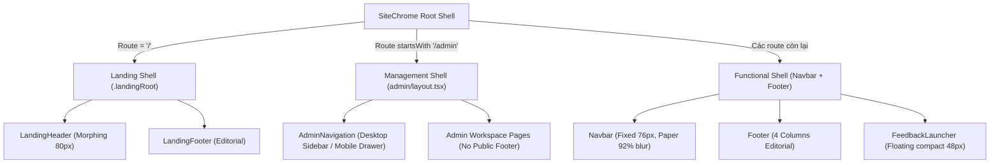

# VISTRA UI/UX Design System Specification & Cross-Project Direction Guide

> **Mã tài liệu:** `VISTRA-DS-2026-v1.0`  
> **Phiên bản:** 1.0 (Production-Verified & Source-Faithful)  
> **Đối tượng sử dụng:** Design System Analysts, UI/UX Engineers, AI Agents tái sử dụng ngôn ngữ thiết kế VISTRA cho dự án mới.  
> **Phạm vi khảo sát:** Toàn bộ mã nguồn frontend VISTRA (`src/`, `docs/`, `config/`), bao gồm 10 cụm routes thực tế, 2 hệ shell độc lập (User-facing & Management), các design token trong CSS Modules/Tailwind `@theme`, và 48 bằng chứng Playwright MCP.  
> **Ngày khảo sát:** 03/10/2026 | **Nhánh Git:** `BinhNT` | **Trạng thái mã nguồn:** Bảo toàn nguyên vẹn 100%, không chỉnh sửa code hay config.

---

## Mục lục

1. [Tóm tắt ngôn ngữ thiết kế (Brand Aesthetics & Philosophy)](#1-tóm-tắt-ngôn-ngữ-thiết-kế-brand-aesthetics--philosophy)
2. [Nguyên tắc thiết kế (Core Design Principles)](#2-nguyên-tắc-thiết-kế-core-design-principles)
3. [Theme và Bảng màu chuẩn (Color System & Semantic Tokens)](#3-theme-và-bảng-màu-chuẩn-color-system--semantic-tokens)
4. [Hệ thống Typography và Bố cục Không gian (Type & Layout System)](#4-hệ-thống-typography-và-bố-cục-không-gian-type--layout-system)
5. [Ngôn ngữ Thành phần (Component Language & Patterns)](#5-ngôn-ngữ-thành-phần-component-language--patterns)
6. [Hành vi Tương tác và Mẫu trải nghiệm (Interaction & UX Patterns)](#6-hành-vi-tương-tác-và-mẫu-trải-nghiệm-interaction--ux-patterns)
7. [Khả năng Thích ứng Đa thiết bị và Tiếp cận (Responsive & Accessibility)](#7-khả-năng-thích-ứng-đa-thiết-bị-và-tiếp-cận-responsive--accessibility)
8. [Bản đồ Thiết kế Từng Trang (Page-by-Page Design Map)](#8-bản-đồ-thiết-kế-từng-trang-page-by-page-design-map)
9. [Bộ Quy tắc Trải nghiệm Đặc thù Ngành Du lịch (Travel-Specific UX Rules)](#9-bộ-quy-tắc-trải-nghiệm-đặc-thù-ngành-du-lịch-travel-specific-ux-rules)
10. [Hướng dẫn Áp dụng sang Dự án Khác (Cross-Project Reuse Guide)](#10-hướng-dẫn-áp-dụng-sang-dự-án-khác-cross-project-reuse-guide)
11. [Bảng Chứng cứ và Nguồn Tham chiếu (Evidence & Source Ledger)](#11-bảng-chứng-cứ-và-nguồn-tham-chiếu-evidence--source-ledger)

---

## Quy ước Gắn nhãn Độ tin cậy (Confidence Classification)

Toàn bộ các quy tắc, giá trị token và nhận định trong tài liệu này được kiểm chứng và gắn nhãn theo 5 cấp độ chuẩn mực:

- **[Đã triển khai + đã xem trên UI]**: Khẳng định đã được tìm thấy trong mã nguồn hoạt động (`src/`), khớp với computed styles và đã được kiểm chứng trực quan qua giao diện render Playwright MCP (ghi nhận tại `docs/evidence/playwright/2026-10-03_14-30-00/`).
- **[Đã triển khai, chưa xác minh render]**: Khẳng định đã được hiện thực hóa đầy đủ trong source code (`.tsx`, `.css`, `.ts`) nhưng chưa chạy live render trong phiên khảo sát hiện tại do dev server không chạy ngầm.
- **[Chỉ có trong tài liệu]**: Quy định có trong tài liệu hướng dẫn (`docs/guides/`, `docs/plans/`) nhưng chưa được chuyển hóa thành code hoặc đã bị mã nguồn v4 ghi đè.
- **[Suy luận]**: Đúc kết từ nhiều chi tiết kiến trúc, tương tác và logic dữ liệu; có ghi rõ căn cứ phân tích.
- **[Chưa rõ/mâu thuẫn]**: Trường hợp mã nguồn, tài liệu hoặc trải nghiệm có sự phân kỳ; tài liệu nêu rõ hai chiều và phán quyết áp dụng.

---

## 1. Tóm tắt ngôn ngữ thiết kế (Brand Aesthetics & Philosophy)

### 1.1. Cảm xúc thương hiệu cốt lõi: "Serene Editorial Voyage"
- **Định vị cảm xúc:** **[Đã triển khai + đã xem trên UI]** VISTRA mang lại cảm giác của một cuốn kỷ yếu hành trình cao cấp (*Editorial Travel Dossier*) kết hợp áp phích du lịch cổ điển (*Vintage Travel Poster*) và bàn làm việc hiện đại. Phong thái chủ đạo là trang nhã, tĩnh lặng, tự nhiên, tôn vinh chiều sâu cảnh quan và nhịp độ thư thái (Đà Lạt sương sớm ven hồ, Sa Pa mùa lúa chín, rừng thông bạt ngàn), hoàn toàn đối lập với phong cách du lịch thương mại xô bồ, săn giá rẻ hay check-in vội vã.
- **Tên gọi phong cách trong dự án:**
  - *Tên trong tài liệu nền tảng:* **"Geometric Editorial Travel with Atmospheric Depth"** ([source_faithful_visual_style_guide.md](file:///c:/Users/yuuki/Documents/ChatGPT/CodexWithChatGPT/P-103/frontend/docs/guides/source_faithful_visual_style_guide.md#L142-L156)).
  - *Tên thương hiệu trải nghiệm:* **"Serene Editorial Voyage"** ([src/app/layout.tsx](file:///c:/Users/yuuki/Documents/ChatGPT/CodexWithChatGPT/P-103/frontend/src/app/layout.tsx#L20), [LandingHero.tsx](file:///c:/Users/yuuki/Documents/ChatGPT/CodexWithChatGPT/P-103/frontend/src/components/landing/hero/LandingHero.tsx#L35)). Cả hai tên gọi đều hợp lệ và bổ trợ cho nhau: một tên mô tả cấu trúc hình học / màu sắc, một tên mô tả linh hồn trải nghiệm.
- **Người dùng mục tiêu:** Du khách độc lập, gia đình đa thế hệ, nhóm bạn trân trọng trải nghiệm bản địa chất lượng cao, các nhà điều hành hành trình cần một công cụ vừa truyền cảm hứng vừa đối chiếu tính khả thi thực tế chặt chẽ.

### 1.2. Sự khác biệt triệt để với "Generic AI SaaS"
Giao diện VISTRA chủ động bẻ gãy các khuôn mẫu AI thông thường:
1. **Loại bỏ Cyberpunk & Magic Sparkle:** **[Đã triển khai + đã xem trên UI]** Không nền đen tím huyền bí, không viền neon phát sáng, không biểu tượng "cây đũa thần ma thuật" (`sparkles` hay `magic AI`). AI trong VISTRA không phải một pháp sư tạo ra ảo ảnh, mà là một **Travel Intelligence Atelier** — người đồng hành am hiểu địa phương.
2. **Kiềm chế tối đa sắc tím AI:** **[Đã triển khai + đã xem trên UI]** Màu tím (`--vistra-ai-violet: #7C3AED`) chỉ chiếm chưa đầy **2%** diện tích thị giác, chỉ xuất hiện làm điểm nhấn nhãn tác nhân phụ trợ trong tài liệu, hoàn toàn không đóng vai trò màu nhận diện thương hiệu.
3. **Nền giấy ấm liên tục (Unified Warm Canvas):** **[Đã triển khai + đã xem trên UI]** Thay vì nền xám lạnh `#F3F4F6` hay trắng toát `#FFFFFF` của các phần mềm doanh nghiệp SaaS, VISTRA sử dụng nền giấy ấm tự nhiên (`#EBF1F0`), tạo cảm giác như trang tạp chí in ấn mờ mắt dưới ánh sáng tự nhiên.
4. **Trực quan hóa đánh đổi thay vì hứa hẹn viển vông:** **[Đã triển khai + đã xem trên UI]** Không có các chỉ số phóng đại giả tạo như *"Khớp ý định 99.9%"* hay *"Tối ưu bằng mạng nơ-ron đa tác nhân"*. Thay vào đó, UI tập trung trình bày các dữ kiện vật lý: cung đường gom cụm bán kính 3km, chặng đèo tiết kiệm 2 giờ di chuyển, cảnh báo mưa sương mù tại thời điểm khởi hành.

---

## 2. Nguyên tắc thiết kế (Core Design Principles)

### 2.1. Nhóm nguyên tắc hiện có (Đã chứng thực trong VISTRA)

#### Nguyên tắc 1: Cung đường & Điểm đến là trung tâm tuyệt đối (Travel First, Tech Second)
- **[Đã triển khai + đã xem trên UI]** Giao diện luôn tôn vinh cảnh quan và thông tin địa lý. Ảnh chụp thực tế tỉ lệ 4:3 và 16:9, bản đồ OpenStreetMap tương tác thực tế với đường nối các chặng (`GeographicMapPanel.tsx`), đường đồng mức địa hình cao nguyên vector (`HeroGeoScene.tsx`) luôn chiếm vị trí thị giác danh dự. Công nghệ AI phục vụ việc làm sáng tỏ hành trình, không đứng ra che lấp cảnh quan.

#### Nguyên tắc 2: Hội thoại là phương thức kiến tạo, không phải đích đến cuối cùng
- **[Đã triển khai + đã xem trên UI]** Luồng chat trong `/planner` không phải là một cửa sổ chat cô lập như ChatGPT. Khung hội thoại (Panel 1 - 5 cột) được đặt song song đồng bộ với Bàn làm việc lịch trình (Panel 2 - 4/7 cột) và Bản đồ địa lý (Panel 3 - 3 cột). Mỗi tin nhắn người dùng gửi đi lập tức cập nhật thời gian thực vào các thẻ hoạt động, hiển thị chi phí dự toán và định vị trạm dừng trên bản đồ.

#### Nguyên tắc 3: AI đề xuất — Con người làm chủ & Chốt phương án (Human Agency & Co-Creation)
- **[Đã triển khai + đã xem trên UI]** Hệ thống luôn phân định rõ ràng giữa:
  - **Dữ kiện thực tế (Facts):** Giờ mở cửa, khoảng cách km, tình trạng thời tiết (do Reality Agent cung cấp với nguồn dẫn chứng minh bạch tại `SourcesModal.tsx`).
  - **Gợi ý của AI (Suggestions):** Nhãn `Khuyên dùng · Êm ả`, các đề xuất giảm đèo dốc.
  - **Trạng thái hành trình:** Bản nháp chưa chốt (`DRAFT` kèm cảnh báo viền vàng cam `#E7AD2E`) $\longrightarrow$ Hồ sơ chính thức (`CONFIRMED` kèm huy hiệu mực Navy `#0E1D4F` và mã định danh trung lập `VST-xxxxx`). Người dùng phải chủ động bấm nút "Chốt phương án này" (`ConfirmPlanDialog.tsx`) thì lịch trình mới chuyển trạng thái.

#### Nguyên tắc 4: Ưu tiên đọc hiểu, định hướng không gian & Giảm nhiễu thị giác
- **[Đã triển khai + đã xem trên UI]** Phân bổ lề thoáng đãng (`max-w-[1320px]` trên Landing, `max-w-[1720px]` trên Bàn làm việc Planner). Mọi panel đều có thanh cuộn độc lập (`overflow-y-auto`), loại bỏ triệt để hiện tượng "bẫy cuộn trang" (scroll chaining) và triệt tiêu tình trạng trang bị cuộn giật nảy lên đầu trang khi tương tác tab.

#### Nguyên tắc 5: Bằng chứng cụ thể thay thế cam kết trừu tượng
- **[Đã triển khai + đã xem trên UI]** Tại các màn hình so sánh điểm đến (`ComparisonDialog.tsx`), UI hiển thị bảng đối chiếu đánh đổi (Trade-off Matrix) trực quan: Điểm được (Gains) vs Điểm mất (Sacrifices), ví dụ: *"Tắm suối nước nóng & không gian tĩnh mịch"* đổi lấy *"Đường đèo quanh co 45 phút, không có xe buýt lớn"*.

### 2.2. Gợi ý áp dụng cho Project khác (Cross-Project Recommendations)
1. **Không lạm dụng Chatbot Full-screen:** Nếu dự án đích có yếu tố AI tạo sinh (GenAI), hãy dùng bố cục **Asymmetric Workbench** (Chia đôi: một bên là tương tác gợi mở, một bên là kết quả hiển thị cấu trúc được lưu giữ) thay vì một ô chat trống rỗng.
2. **Giữ nhịp điệu giấy mờ (Paper & Glass):** Nền giấy ấm kết hợp các thẻ nổi `backdrop-filter: blur(12px)` tạo ra trải nghiệm đọc êm dịu, phù hợp cho các sản phẩm giáo dục, tài chính gia đình, sức khỏe tinh thần hoặc bất động sản nghỉ dưỡng.
3. **Cơ chế Proof/Sources Popover:** Mọi thông tin do AI tự sinh cần có nút bấm xem nguồn (`Nguồn đối chiếu thực tế`) để người dùng có thể kiểm tra tính xác thực của dữ liệu bất cứ lúc nào.

---

## 3. Theme và Bảng màu chuẩn (Color System & Semantic Tokens)

### 3.1. Nguồn chân lý của hệ màu trong Project
Hệ màu VISTRA được thiết lập qua 2 tầng mã nguồn đồng bộ:
1. **Tầng toàn cục (Global Foundation):** Khai báo tại [src/app/globals.css](file:///c:/Users/yuuki/Documents/ChatGPT/CodexWithChatGPT/P-103/frontend/src/app/globals.css#L29-L110) thông qua chỉ thị Tailwind `@theme`.
2. **Tầng Scoped Landing Page:** Khai báo tại [src/components/landing/landing.module.css](file:///c:/Users/yuuki/Documents/ChatGPT/CodexWithChatGPT/P-103/frontend/src/components/landing/landing.module.css#L6-L34) trong `.landingRoot`.

> **[Đã triển khai + đã xem trên UI]** Sự thống nhất quan trọng: Bảng màu cũ `--color-primary: #0b3b3c` (xanh thông sẫm) và `--color-secondary: #b45309` (cam đất) đã được loại bỏ hoàn toàn. Toàn bộ ứng dụng từ Landing Page tới các trang chức năng và Admin hiện thống nhất sử dụng hệ màu Reference B làm chủ đạo, Reference A làm bổ trợ.

### 3.2. Bảng kê Semantic Color Palette Chi tiết

| Token Tên chuẩn | Giá trị HEX | Giá trị RGB / Alpha | Vai trò Semantic (Thiết kế) | Vị trí áp dụng thực tế | Tương phản phù hợp (Background) | Trạng thái xác minh |
|---|---|---|---|---|---|---|
| `--color-paper` / `--lp-paper` | `#EBF1F0` | `rgb(235, 241, 240)` | **Nền giấy liên tục toàn ứng dụng** (Warm Neutral Canvas), thay thế nền trắng toát hoặc xám lạnh. | Thẻ `<body>`, toàn bộ nền trang `/`, `/planner`, `/destinations`, `/my-trips`, `/admin`. | Chứa text `#0E1D4F` (Tỉ lệ tương phản ~12.5:1, đạt chuẩn WCAG AAA). | **[Đã triển khai + đã xem trên UI]** |
| `--color-ink` / `--lp-ink` | `#0E1D4F` | `rgb(14, 29, 79)` | **Màu mực Navy chính (Primary Ink)**; tiêu đề H1/H2, nhãn quan trọng, nét viền kiến trúc, logo. | Header brand text, H1/H2 toàn hệ thống, viền thẻ active, icon chính. | Hiển thị sắc nét trên nền `#EBF1F0` và card trắng `#FFFFFF`. | **[Đã triển khai + đã xem trên UI]** |
| `--color-ink-muted` / `--lp-muted` | `#4B5875` | `rgb(75, 88, 117)` | **Màu mực phụ (Secondary Text)**; văn bản mô tả, ghi chú timeline, phụ đề, label thứ cấp. | Thẻ `.bodySub`, đoạn giải thích chặng, mô tả địa điểm, icon muted. | Đặt trên nền `#EBF1F0` hoặc `#FFFFFF` (Tỉ lệ ~4.8:1, đạt WCAG AA). | **[Đã triển khai + đã xem trên UI]** |
| `--color-surface-bright` | `#FFFFFF` | `rgb(255, 255, 255)` | **Bề mặt thẻ nổi đặc (Solid Surface)**. | Thẻ form nhập liệu, modal đối chiếu, menu dropdown, thanh command bar. | Viền bao `#0E1D4F/10` để tách biệt khỏi nền giấy. | **[Đã triển khai + đã xem trên UI]** |
| `--color-surface-container-low` | `rgba(255, 255, 255, 0.65)` | Alpha 0.65 | **Bề mặt thẻ bán trong suốt (Glassmorphic Card)** kết hợp `backdrop-filter: blur(12px)`. | Thẻ Overview trên Landing, bong bóng chat AI, panel timeline, widget nổi. | Cho phép chất liệu nền hoặc vector địa hình xuyên thấu nhẹ. | **[Đã triển khai + đã xem trên UI]** |
| `--color-turquoise` / `--lp-forest` | `#08B3C6` | `rgb(8, 179, 198)` | **Màu nhận diện thương hiệu du lịch (Brand Accent)**; nét viền tập trung, icon highlight, chòm sao khám phá. | Logo icon container, focus ring bàn phím, chặng active trên bản đồ, tag cộng đồng. | Nền tối `#0E1D4F` hoặc nền mờ `rgba(8,179,198,0.15)`. | **[Đã triển khai + đã xem trên UI]** |
| `--color-turquoise-hover` | `#15A6B4` | `rgb(21, 166, 180)` | **Hover tương tác của màu ngọc bích**. | Hover nút icon, hover chip lọc. | Đặt trên nền giấy hoặc trắng. | **[Đã triển khai + đã xem trên UI]** |
| `--color-royal-blue` / `--lp-clay` | `#205BD6` | `rgb(32, 91, 214)` | **Màu nút hành động chính (Primary CTA)**; liên kết active, chốt kế hoạch, nút Lên kế hoạch. | Nút `btnPrimary`, nút "Lên kế hoạch mới", tab active, link điều hướng đang mở. | Chữ trắng `#FFFFFF` (Tỉ lệ tương phản 4.6:1, đạt chuẩn WCAG AA). | **[Đã triển khai + đã xem trên UI]** |
| `--color-on-secondary-container` | `#0739A8` | `rgb(7, 57, 168)` | **Trạng thái hover sâu của CTA chính**; text tiêu đề liên kết quan trọng. | `hover:bg-[#0739A8]`, nhãn phân loại cấp cao. | Nền xanh hoàng gia hoặc nền giấy. | **[Đã triển khai + đã xem trên UI]** |
| `--color-sun-accent` / `--lp-ochre` | `#E7AD2E` | `rgb(231, 173, 46)` | **Điểm nhấn nắng ấm (Sun Accent)**; chặng đang diễn ra, điểm sao vàng, cảnh báo tích cực, nhãn Bản nháp. | Nút marker chặng đang đi trên map, banner trạng thái `DRAFT`, badge cảnh báo. | Đặt trên nền mờ `rgba(231,173,46,0.15)` với chữ Navy sẫm. | **[Đã triển khai + đã xem trên UI]** |
| `--color-sun-warm` | `#F4DB38` | `rgb(244, 219, 56)` | **Vàng sáng chòm sao**. | Dải kết nối hoàn tất trên `StarSkyCanvas.tsx`. | Nền không gian tối hoặc vector. | **[Đã triển khai + đã xem trên UI]** |
| `--vistra-aqua` / `-soft` | `#9DD8E2` & `#6AD6EF` | `rgb(157,216,226)` | **Màu nước hồ / Bầu trời cao nguyên**. | Vector nền `HeroGeoScene.tsx`, ngôi sao mờ trên canvas. | Nền chuyển tiếp khí quyển. | **[Đã triển khai + đã xem trên UI]** |
| `--vistra-mint` / `--vistra-cyan` | `#9FEFC7` & `#10E4D0` | `rgb(159,239,199)` | **Tầng sương mây khí quyển (Reference A)**. | Lớp địa hình tier 1–3 trong `HeroGeoScene.tsx`. | Nền khí quyển đỉnh đầu trang. | **[Đã triển khai + đã xem trên UI]** |
| `--vistra-ai-violet` | `#7C3AED` | `rgb(124, 58, 237)` | **Điểm xuyết công nghệ AI (Tối đa 2% diện tích)**. | Tag phân loại tác nhân ngầm trong văn bản kỹ thuật. | Bị kiềm chế nghiêm ngặt, không dùng làm màu nền hay nút chính. | **[Đã triển khai + đã xem trên UI]** |
| `--color-error` | `#BA1A1A` | `rgb(186, 26, 26)` | **Màu trạng thái lỗi, nguy hiểm, xóa bản ghi**. | Thông báo lỗi form đăng nhập, nút khóa tài khoản admin, cảnh báo vi phạm ràng buộc. | Nền hồng nhạt `#FFDAD6` với chữ `#93000A`. | **[Đã triển khai + đã xem trên UI]** |
| `--color-outline` | `rgba(14, 29, 79, 0.20)` | Alpha 0.20 | **Đường viền ngăn cách cấu trúc**. | Viền thẻ nội dung, viền input form, viền bảng quản trị. | Nền giấy `#EBF1F0` hoặc bề mặt trắng `#FFFFFF`. | **[Đã triển khai + đã xem trên UI]** |
| `--color-outline-variant` | `rgba(14, 29, 79, 0.10)` | Alpha 0.10 | **Đường viền phân tách mờ nội bộ**. | Kẻ chỉ giữa các dòng table, vách ngăn danh sách hoạt động trong ngày. | Nền thẻ. | **[Đã triển khai + đã xem trên UI]** |

### 3.3. Tỷ lệ Phân bổ Màu Sắc Toàn Cục (Global Chromatic Ratio)
- **Nền giấy ấm (`#EBF1F0`):** **~45%** (Tạo không gian thở tự nhiên, làm dịu thị giác).
- **Thẻ trắng & Kính mờ (`rgba(255,255,255, 0.65–0.90)`):** **~25%** (Cấu trúc thông tin phân tầng rõ ràng).
- **Màu mực Navy (`#0E1D4F`):** **~15%** (Khung xương chữ, tiêu đề, tạo cảm giác tin cậy vững chãi).
- **Xanh hoàng gia (`#205BD6`) & Xanh ngọc (`#08B3C6`):** **~10%** (Dẫn dắt hành động và định hướng chú ý).
- **Vàng nắng ấm (`#E7AD2E` / `#F4DB38`):** **~3–4%** (Điểm xuyết nhịp điệu thời gian và cảnh báo).
- **Xanh bạc hà / Tím hỗ trợ:** **~1–2%** (Khí quyển chuyển cảnh).

---

## 4. Hệ thống Typography và Bố cục Không gian (Type & Layout System)

### 4.1. Cấu hình Font Family và Tải Font
Khai báo tại [src/app/layout.tsx](file:///c:/Users/yuuki/Documents/ChatGPT/CodexWithChatGPT/P-103/frontend/src/app/layout.tsx#L6-L16):
- **Font chính (`--font-body`):** `Plus Jakarta Sans` (Google Fonts, weights: 400, 500, 600, 700; subsets: `latin, vietnamese`).
  - *Đặc tính hình học:* Khung xương hình học hiện đại (geometric sans), mắt chữ thoáng, độ cao x-height lớn, các nét bo tròn tạo cảm giác thân thiện, thanh lịch và ấm áp. Dùng cho toàn bộ Tiêu đề (H1, H2, H3), Nội dung chính (Body Text), Nút bấm và Trích dẫn.
- **Font nhãn/kỹ thuật (`--font-label`):** `Inter` (Google Fonts, weights: 400, 500, 600, 700; subsets: `latin, vietnamese`).
  - *Đặc tính hình học:* Trung tính, độ chính xác cao ở kích thước nhỏ. Dùng cho Nhãn kỹ thuật (Uppercase Eyebrow), Badge mã hành trình (`VST-xxxxx`), Số liệu tọa độ, Giờ giấc timeline, Nhãn phân loại bảng quản trị.

### 4.2. Thang đo Phân cấp Chữ (Type Scale Hierarchy)

| Cấp bậc Chữ | Class Tailwind / CSS | Kích thước Font | Line-Height | Font-Weight | Letter-Spacing | Mục đích sử dụng thực tế |
|---|---|---|---|---|---|---|
| **Display H1** | `.h1` / `text-4xl sm:text-5xl` | `clamp(38px, 4.5vw, 68px)` | `1.05` | `700` (Bold) | `-0.025em` | Tuyên ngôn trang chủ ("Chuyến đi đáng để mong chờ") |
| **Headline Large** | `.font-headline-lg` / `text-2xl sm:text-4xl` | `1.875rem` – `2.25rem` (30–36px) | `1.15` – `1.2` | `700` (Bold) | `-0.02em` | Tiêu đề chính của các trang nghiệp vụ (`/create-trip`, `/planner`, `/destinations`) |
| **Headline Medium** | `.font-headline-md` / `text-xl sm:text-2xl` | `1.25rem` – `1.5rem` (20–24px) | `1.25` | `600` (Semibold) | `-0.01em` | Tiêu đề Card, Tên phương án (Option A/B), Tên ngày trong lịch trình |
| **Headline Small** | `.font-headline-sm` / `text-lg` | `1.125rem` (18px) | `1.3` | `600` (Semibold) | `0` | Tiêu đề danh mục con, tên địa điểm con trong ngày |
| **Body Large** | `.font-body-lg` / `text-body-lg` | `1.125rem` (18px) | `1.55` | `500` (Medium) | `0` | Đoạn dẫn nhập mở đầu trang, lời bình biên tập |
| **Body Medium** | `.font-body-md` / `text-body-md` | `0.9375rem` (15px) | `1.5` | `400` / `500` | `0` | Nội dung mô tả thẻ hành trình, tin nhắn hội thoại AI & Du khách |
| **Body Small** | `.font-body-sm` / `text-body-sm` | `0.8125rem` (13px) | `1.4` | `400` (Regular) | `0` | Ghi chú di chuyển, chi tiết khoảng cách km, phụ đề chân trang |
| **Label Large** | `.font-label-lg` / `text-label-lg` | `0.875rem` (14px) | `1.25` | `600` (Semibold) | `0.01em` | Chữ trên nút bấm (Button CTA), tab điều hướng chính |
| **Label Medium** | `.font-label-md` / `text-label-md` | `0.75rem` (12px) | `1.0` | `500` (Medium) | `0.02em` | Nhãn form, chip thông số (Số khách, Ngân sách) |
| **Label Caps** | `.font-label-caps` / `text-label-caps` | `0.6875rem` (11px) | `1.0` | `700` (Bold) | `0.08em` (Uppercase) | Mã số hồ sơ (`VST-xxxxx`), nhãn bước quy trình (`01 / CẢM HỨNG`), KPI Admin |

### 4.3. Hệ thống Khung chứa (Container) và Lưới 12 Cột (12-Column Grid)
- **Container Giới hạn Chiều rộng (Max-Width Standards):**
  - **Trang Giới thiệu / Editorial (`/`):** `max-width: 1320px` ([landing.module.css#L90-L98](file:///c:/Users/yuuki/Documents/ChatGPT/CodexWithChatGPT/P-103/frontend/src/components/landing/landing.module.css#L90-L98)). Lề ngang: `16px` (mobile), `24px` (tablet), `60px` (desktop $\ge$ 1440px). Đảm bảo nhịp đọc chuẩn tạp chí, không bị bè ngang trên màn hình siêu rộng.
  - **Trang Danh mục & Hồ sơ (`/destinations`, `/my-trips`, `/trip-plan`, `/profile`):** `max-width: 1440px`. Lề ngang: `px-4 sm:px-6 lg:px-12`.
  - **Trang Tác nghiệp Bàn làm việc (`/planner`, `/community`):** `max-width: 1720px`. Cung cấp không gian tối đa để chứa đồng thời 3 cột thao tác (Chat + Timeline + Bản đồ) mà không làm co cụm thông tin.
- **Lưới 12 Cột Đột phá (Asymmetric Workbench Pattern):**
  - Khai báo: `grid grid-cols-1 lg:grid-cols-12 gap-6 items-start`.
  - Phân bổ cột bất đối xứng kinh điển của VISTRA:
    - **Cột Trái (5 Cột):** Bảng đàm thoại cùng AI (`ChatPanel.tsx`), bao gồm dòng thời gian hội thoại, bộ câu hỏi gợi ý nhanh và khung soạn thảo văn bản.
    - **Cột Giữa (4 Cột khi mở bản đồ, 7 Cột khi thu gọn bản đồ):** Bàn làm việc lịch trình chi tiết (`ItineraryPanel.tsx`) với thẻ hoạt động, thời gian di chuyển, phương tiện và chi phí.
    - **Cột Phải (3 Cột hoặc nút ghim thu gọn):** Bản đồ OpenStreetMap vệ tinh/địa lý thực tế (`GeographicMapPanel.tsx`) kết nối trực quan các điểm đến theo thứ tự thời gian.

### 4.4. Thang Bo góc (Border Radius) & Đổ bóng (Shadows / Elevation)
- **Thang Bo góc Hình học (Geometric Radius Scale):**
  - `8px` (`rounded-lg`): Nút phụ nhỏ, ô input, dropdown select, chip lọc.
  - `12px` – `14px` (`rounded-xl`): Nút bấm CTA chuẩn, logo icon container, bong bóng chat, thẻ hoạt động timeline con.
  - `16px` – `20px` (`rounded-2xl`): Thẻ hành trình lớn (`TripCard`), bảng điều khiển quản trị, panel làm việc, hộp thoại modal.
  - `24px` (`rounded-3xl`): Canvas thiên văn lớn, khung bản đồ vệ tinh.
  - `9999px` (`rounded-full`): Viên thuốc (Pill badges), avatar đại diện, nút đóng tròn, nút phản hồi compact.
- **Thang Đổ bóng Tinh tế (Subtle Shadows):** Tránh các bóng đen đậm cục mịch của giao diện web thông thường:
  - *Thẻ tĩnh:* `box-shadow: 0 2px 12px rgba(14, 29, 79, 0.04)`.
  - *Thẻ tương tác / Hover:* `box-shadow: 0 8px 24px -4px rgba(32, 91, 214, 0.18), 0 0 0 1px #205BD6`.
  - *Floating Bar / Header cuộn:* `box-shadow: 0 10px 30px -4px rgba(14, 29, 79, 0.12)`.
  - *Modal Hộp thoại:* `box-shadow: 0 25px 50px -12px rgba(14, 29, 79, 0.25)`.

---

## 5. Ngôn ngữ Thành phần (Component Language & Patterns)

### 5.1. Hệ Thống Thanh Điều Hướng (Shell & Navigation)
VISTRA phân tách rõ ràng 2 không gian trải nghiệm qua [src/components/layout/SiteChrome.tsx](file:///c:/Users/yuuki/Documents/ChatGPT/CodexWithChatGPT/P-103/frontend/src/components/layout/SiteChrome.tsx):

#### A. Header Biến hình Trang chủ (Morphing LandingHeader)
- **[Đã triển khai + đã xem trên UI]** Khai báo tại [LandingHeader.tsx](file:///c:/Users/yuuki/Documents/ChatGPT/CodexWithChatGPT/P-103/frontend/src/components/landing/LandingHeader.tsx).
- **Trạng thái đỉnh trang (ScrollY $\le$ 80px):** Tràn 100% chiều rộng, nền giấy mờ `rgba(235, 241, 240, 0.80)`, `backdrop-filter: blur(12px)`, viền đáy mảnh `1px solid rgba(14, 29, 79, 0.08)`.
- **Trạng thái cuộn (ScrollY > 80px):** Tự động co lại thành **đảo nổi bo góc (Floating Pill)**:
  - Chiều rộng: `clamp(760px, 60vw, 1180px)`, cách đỉnh `14px`, bo góc `20px`.
  - Bề mặt: `rgba(255, 255, 255, 0.60)`, `backdrop-filter: blur(16px)`, đổ bóng `0 10px 30px -4px rgba(14, 29, 79, 0.12)`.
  - Các mục menu có gạch chỉ tiến trình và highlight `#205BD6` khi phần tử tương ứng đang nằm trong tầm nhìn (tích hợp `IntersectionObserver` với `rootMargin: '-76px 0px -40% 0px'`).

#### B. Navbar Chức năng Cố định (Functional Navbar)
- **[Đã triển khai + đã xem trên UI]** Khai báo tại [Navbar.tsx](file:///c:/Users/yuuki/Documents/ChatGPT/CodexWithChatGPT/P-103/frontend/src/components/layout/Navbar.tsx).
- Cố định đỉnh màn hình `fixed top-0 left-0 right-0 h-[76px] z-50`. Nền `#EBF1F0/92`, viền đáy `border-[#0E1D4F]/10`.
- Nội dung: Logo VISTRA + slogan `Travel Intelligence`, các liên kết danh mục (`Chuyến đi của tôi`, `Điểm đến`, `Cộng đồng`), nút Đăng nhập (`/login`), nút bấm chính "+ Lên kế hoạch" (`/create-trip`) và nút Avatar tài khoản du khách (`VS`).
- **An toàn quản trị:** Không chứa bất kỳ liên kết nào tới `/admin` trên thanh điều hướng du khách (đã khắc phục hoàn toàn theo `AUD-01`).

#### C. Khung Điều hướng Quản trị (Admin Sidebar & Topbar Drawer)
- **[Đã triển khai + đã xem trên UI]** Khai báo tại [AdminNavigation.tsx](file:///c:/Users/yuuki/Documents/ChatGPT/CodexWithChatGPT/P-103/frontend/src/components/admin/AdminNavigation.tsx).
- **Desktop ($\ge$ 768px):** Sidebar cố định bên trái rộng `260px`, nền trắng `bg-white`, đường viền phải `border-r border-[#0E1D4F]/10`. Chứa 5 phân hệ:
  1. *Tổng quan Vận hành* (`/admin`)
  2. *Quản lý Người dùng* (`/admin/users`)
  3. *Theo dõi Doanh thu* (`/admin/revenue`)
  4. *Hòm thư Phản hồi* (`/admin/feedback` - kèm badge số vé chưa xử lý)
  5. *Hạ tầng & Dữ liệu* (`/admin/system`)
- **Mobile (< 768px):** Thanh Topbar nhỏ gọn `h-14` kèm nút Hamburger mở Drawer tràn từ bên trái, có backdrop làm mờ, hỗ trợ phím Escape và khóa cuộn thân trang.

### 5.2. Hệ thống Nút bấm & Hành động (CTA & Controls)
- **Primary Action Button (`.btnPrimary` / `bg-[#205BD6]`):**
  - Chiều cao tối thiểu `50px` (desktop) hoặc `44px` (touch mobile).
  - Nền Royal Blue `#205BD6`, chữ trắng, bo góc `14px`. Hover chuyển `#0739A8`, nâng nhẹ `translateY(-1px)`, đổ bóng `0 6px 16px rgba(7, 57, 168, 0.3)`. Active: `scale(0.98)`.
  - Focus Ring bắt buộc: `outline: 3px solid #08B3C6; outline-offset: 2px;` (WCAG 2.1 Focus Visible).
- **Secondary Button (`.btnSecondary` / `bg-white border-[#0E1D4F]/15`):**
  - Nền trắng, viền mảnh `1.5px solid rgba(14, 29, 79, 0.2)`, chữ Navy `#0E1D4F`. Hover đổi viền và chữ sang `#205BD6`.
- **Icon Button:** Kích thước chạm tối thiểu `40x40px` (chuẩn mobile), bo tròn `rounded-xl` hoặc `rounded-full`, có `aria-label` minh bạch.
- **Hệ thống Icon Đồ họa (`Icon.tsx`):**
  - **[Đã triển khai + đã xem trên UI]** Toàn bộ icon dùng định dạng SVG nét đơn (Linear Outline), `viewBox="0 0 24 24"`, `strokeWidth="1.8"`, `strokeLinecap="round"`, `fill="none"`, `stroke="currentColor"`. Tuyệt đối không dùng icon 3D bóng bẩy hoặc icon đổ bóng lòe loẹt.

### 5.3. Thẻ, Bảng điều khiển & Phân trang (Cards, Panels & Data Blocks)
- **Thẻ Hành trình (`TripCard.tsx`):**
  - Tỉ lệ khung ảnh bìa `16:9` bo tròn góc trên `16px`.
  - Huy hiệu trạng thái trên góc ảnh: `Bản nháp` (Nền vàng `#E7AD2E/20`, viền `#E7AD2E`, chữ `#0E1D4F`) hoặc `Đã xác nhận` (Nền Navy `#0E1D4F`, chữ trắng).
  - Thân thẻ: Tiêu đề H3, mã hồ sơ `VST-xxxxx`, dải ngân sách format chuẩn tiền tệ VNĐ (`15.000.000 đ – 20.000.000 đ`, không bị cắt lửng dấu ba chấm), số ngày/đêm và ngày tạo.
- **Lưới Phân trang Chuẩn 12 Thẻ (4x3 Catalog Grid):**
  - **[Đã triển khai + đã xem trên UI]** Áp dụng đồng bộ trên `/my-trips` và `/community`: 12 thẻ/trang trên desktop (lưới 4 cột x 3 hàng, hoặc 3 cột x 4 hàng tùy breakpoint), có thanh chuyển trang trực quan với số trang rõ ràng (Trang 1 / 3).
- **Thẻ KPI Quản trị (`AdminKpiSummary.tsx`):**
  - 5 chỉ số vận hành cốt lõi: Người dùng hoạt động, Doanh thu thực tế, Tỷ lệ chốt phương án, Độ trễ tác nhân AI, Số phản hồi chờ duyệt.
  - Hiển thị số liệu thực tế kèm tỷ lệ biến thiên (+12.4%), không dùng sao đánh giá giả tạo.

### 5.4. Giao diện Hội thoại & Soạn thảo (Chat & Composer)
- **Bong bóng Hội thoại (`ChatPanel.tsx`):**
  - **Tin nhắn AI (Vistra):** Nền bán trong suốt `rgba(255, 255, 255, 0.85)`, viền mảnh `#0E1D4F/10`, góc bo `16px` (trừ góc trên trái bo `4px`). Có nhãn tác nhân kèm icon (`Visual Agent`, `Reality Agent`) và nút mở trích dẫn nguồn.
  - **Tin nhắn Du khách:** Nền xanh hoàng gia mờ `rgba(32, 91, 214, 0.12)`, viền `rgba(32, 91, 214, 0.25)`, góc bo `16px` (trừ góc trên phải bo `4px`), chữ Navy `#0E1D4F`.
- **Khung Soạn thảo (Composer):** Ô nhập liệu tự co giãn chiều cao theo nội dung, phím tắt `Enter` để gửi tin, `Shift + Enter` để xuống dòng. Nút gửi tin dạng tròn icon mũi tên, tự động chuyển màu `#205BD6` khi có nội dung chữ.

### 5.5. Bản đồ Tương tác & Tuyến đường (Cartography & GIS)
- **Bản đồ OpenStreetMap Thực địa (`GeographicMapPanel.tsx`):**
  - **[Đã triển khai + đã xem trên UI]** Tích hợp bản đồ slippy tiles OpenStreetMap (`https://tile.openstreetmap.org/{z}/{x}/{y}.png`) với công thức tính toán tọa độ chiếu Mercator trực tiếp.
  - Các mốc điểm đến (Stop Pins): Vòng tròn đánh số thứ tự (1, 2, 3...) màu xanh `#205BD6`, điểm đang chọn màu vàng `#E7AD2E`.
  - Đường nối hành trình (Route Polylines): Đường nét đứt màu xanh ngọc `#08B3C6` nối tuần tự các hoạt động trong ngày.
  - Nút điều khiển: Phóng to (`+`), Thu nhỏ (`-`), Nút đưa về tâm (`Recenter`).
  - Hỗ trợ danh sách các hoạt động chưa có tọa độ (Unpositioned Stops) với thông báo lịch sự, không làm treo bản đồ.

### 5.6. Hộp thoại, Phản hồi & Thông báo (Modals, Toasts & Feedback)
- **Hộp thoại So sánh Điểm đến (`ComparisonDialog.tsx`):**
  - **Desktop:** Bảng 2 cột song song hiển thị các tiêu chí: Khí hậu, Cung đường di chuyển, Trải nghiệm nổi bật, Dự toán chi phí và Đánh đổi.
  - **Mobile (390px):** Tự động chuyển đổi thành giao diện **Tabbed Comparison** với thanh chọn chuyển đổi mượt mà giữa Điểm 1 và Điểm 2, không gây tràn ngang khung hình.
- **Nút Góp ý Trải nghiệm (`FeedbackLauncher.tsx`):**
  - **[Đã triển khai + đã xem trên UI]** Nút nổi tròn compact `48x48px` ở góc dưới màn hình. Tự động mở rộng nhãn chữ khi hover hoặc focus bàn phím.
  - **Định vị thích ứng ngữ cảnh:** Tự động nâng cao vị trí trên `/planner` (`bottom-24` trên mobile để không đè lên khung soạn thảo chat) và trên `/destinations` (`bottom-20` để không đè thanh dock so sánh).

---

## 6. Hành vi Tương tác và Mẫu trải nghiệm (Interaction & UX Patterns)

### 6.1. Điều hướng và Quản lý Tiến trình (Journey Flow)
1. **Luồng Khởi tạo Tuyến đường:**
   $$\text{Trang chủ (/) } \xrightarrow{\text{Nút + Lên kế hoạch}} \text{Tạo chuyến đi (/create-trip)} \xrightarrow{\text{Giải mã DNA}} \text{Bàn làm việc (/planner)} \xrightarrow{\text{Chốt kế hoạch}} \text{Chi tiết (/trip-plan)}$$
2. **Khôi phục Trạng thái Bản nháp (Draft Continuity):**
   Khi du khách quay lại `/create-trip` từ một bản nháp đang dở dang, hệ thống tự động hiển thị thanh thông báo: *"Đang tiếp tục bản nháp: [Tên chuyến đi]"* kèm nút chuyển ngay tới Bàn làm việc `/planner` mà không bắt người dùng nhập lại từ đầu.

### 6.2. Cập nhật Bàn làm việc Không nhảy cuộn (Zero-Scroll-Jumping Workspace)
- **[Đã triển khai + đã xem trên UI]** Khi người dùng chọn chuyển ngày trong lịch trình (Ngày 01 $\rightarrow$ Ngày 02) hoặc gửi câu hỏi cho AI, hệ thống duy trì cố định vị trí cuộn trang toàn cục (`window.scrollY = 0`), chỉ cuộn nội bộ trong container của cột tương ứng.
- Khi có tin nhắn mới từ AI, cột Chat hiển thị nút trôi nổi *"Có tin nhắn mới $\downarrow$"* nếu người dùng đang cuộn lên xem lịch sử trước đó, tránh việc tự động giật màn hình xuống đáy cướp mất dòng đọc của người dùng.

### 6.3. Quản lý Modal và Trình đơn Di động (Focus Trap & Escape Handling)
Toàn bộ các thành phần che phủ (Modals, Dialogs, Mobile Drawers) tuân thủ nghiêm ngặt chuẩn WAI-ARIA:
- **Phím Escape:** Nhấn phím `Escape` lập tức đóng modal/drawer và **hoàn trả con trỏ focus** về đúng nút bấm đã kích hoạt trước đó (`triggerRef.current?.focus()`).
- **Khóa cuộn thân trang (Body Scroll Lock):** Khi modal mở, tự động gán `document.body.style.overflow = 'hidden'`; khi đóng, khôi phục trạng thái ban đầu.
- **Vùng bấm ngoài (Backdrop Click):** Nhấp chuột vào lớp nền mờ bên ngoài hộp thoại sẽ đóng modal an toàn.

### 6.4. Bảo toàn Dữ liệu & Xử lý Trạng thái Ngoại lệ (Fault Tolerance)
- **Lỗi truy vấn ID không tồn tại (`/trip-plan?id=invalid` hoặc `/planner?id=invalid`):**
  - Không ném màn hình lỗi 404 trắng trơn.
  - Hiển thị màn hình thông báo lịch sự với icon minh họa `search_off`, giải thích rõ ràng và cung cấp nút bấm điều hướng quay về *"Chuyến đi của tôi"*.
- **Validation Biểu mẫu Ràng buộc (Negative Range Protection):**
  - Bộ lọc ngân sách và thời gian trên `/my-trips` và `/community`: Nếu người dùng vô tình nhập `Giá tối thiểu > Giá tối đa`, hệ thống không lọc ra kết quả rỗng (0 items) một cách khó hiểu, mà hiển thị ngay dòng cảnh báo màu cam: *"Ngân sách tối thiểu không được lớn hơn ngân sách tối đa"*.

---

## 7. Khả năng Thích ứng Đa thiết bị và Tiếp cận (Responsive & Accessibility)

### 7.1. Breakpoint Thực tế trong Source Code
Hệ thống sử dụng thang breakpoint chuẩn mực của Tailwind CSS v4 kết hợp CSS Container queries:

| Breakpoint Token | Độ rộng tối thiểu | Thiết bị đại diện kiểm thử | Quy tắc tái cấu trúc bố cục (Layout Reflow) |
|---|---|---|---|
| **Mobile (`< 640px`)** | `360px` – `639px` | iPhone 14 / Android (390 × 844, 360 × 800) | 1 cột duy nhất; Header hiển thị icon hamburger; Planner kích hoạt Tab Bar chuyển đổi giữa Chat và Lịch trình; Ẩn bản đồ vào Mobile Drawer Modal; Thẻ so sánh chuyển sang dạng Tabbed; Lưới catalog 1 cột. |
| **Tablet (`md: 768px`)** | `768px` – `1023px` | iPad / Tablet portrait (768 × 1024) | 2 cột; Lưới catalog 2 cột; Bàn làm việc hiển thị Chat (6 cols) + Lịch trình (6 cols); Bản đồ ghim thu gọn; Admin Shell chuyển đổi Sidebar cố định sang chế độ co giãn. |
| **Desktop (`lg: 1024px`)** | `1024px` – `1279px` | Laptop nhỏ (1024 × 768) | Đầy đủ 3 cột bàn làm việc; Lưới catalog 3 cột; Navbar hiển thị đầy đủ liên kết chữ; Modal so sánh hiển thị dạng bảng 2 cột. |
| **Workspace Desktop (`xl: 1280px`)** | `1280px` – `1439px` | Laptop tiêu chuẩn (1280 × 720) | Khống chế chiều cao bàn làm việc `h-[calc(100vh-76px)]` để hiển thị trọn vẹn toàn bộ timeline và khung chat không bị thanh cuộn trình duyệt bao ngoài. |
| **Wide Desktop (`2xl: 1440px+`)** | `1440px` – `1920px` | Màn hình lớn (1440 × 1080, 1920 × 1080) | Lưới catalog 4 cột (4x3); Lề trang mở rộng `60px`; Khung canvas thiên văn và bản đồ hiển thị độ phân giải cao nhất. |

### 7.2. Chuẩn mực Khả năng Tiếp cận (Accessibility & Inclusivity)
- **Độ tương phản chữ (Color Contrast):**
  - Chữ Navy `#0E1D4F` trên nền giấy `#EBF1F0` đạt tỷ lệ `12.5:1` (Vượt ngưỡng AAA `7.0:1`).
  - Chữ trắng `#FFFFFF` trên nút Primary `#205BD6` đạt tỷ lệ `4.6:1` (Vượt ngưỡng AA `4.5:1`).
  - Chữ mô tả `#4B5875` trên nền giấy đạt `4.8:1` (Đạt chuẩn AA).
- **Điều hướng Bàn phím & Focus Ring:**
  - Toàn bộ liên kết và nút bấm có thuộc tính `:focus-visible` với viền đôi nổi bật: `outline: 2px (hoặc 3px) solid #205BD6; outline-offset: 2px;`.
  - Có liên kết ẩn bỏ qua đến nội dung chính (Skip to Content Link) ở đầu trang (`.skipLink`), bấm `Tab` sẽ xuất hiện ngay lập tức để người dùng bàn phím bỏ qua thanh điều hướng.
- **Kích thước Điểm chạm (Touch Target Size):** Mọi nút bấm, tab và icon tương tác trên thiết bị di động đều có kích thước tối thiểu `44 × 44px` (Apple Human Interface Guidelines & WCAG Success Criterion 2.5.5).
- **Hỗ trợ Giảm chuyển động (Prefers-Reduced-Motion):**
  - Kiểm tra `window.matchMedia('(prefers-reduced-motion: reduce)')`. Khi được kích hoạt, toàn bộ hiệu ứng cuộn mượt (`scroll-behavior: smooth`) tự động chuyển thành chuyển bước tức thời (`behavior: 'auto'`), và các vòng lặp tự động chuyển slide dừng chạy.

---

## 8. Bản đồ Thiết kế Từng Trang (Page-by-Page Design Map)

Bảng tổng hợp chi tiết hiện trạng thiết kế trên 10 phân hệ route đã kiểm chứng trong mã nguồn:

| Route URL | Tên Trang / Phân hệ | Shell áp dụng | Mục tiêu Người dùng | Bố cục & Hierarchy cốt lõi | Hành động Chính (Primary) & Phụ | Thành phần & Pattern Nổi bật |
|---|---|---|---|---|---|---|
| `/` | **Trang chủ (Landing Page)** | `LandingShell` (`.landingRoot`) | Tiếp cận triết lý du lịch, khám phá năng lực đa tác nhân và bắt đầu lên kế hoạch. | Container 1320px; 6 section tuần tự: Hero $\rightarrow$ Khám phá $\rightarrow$ Cùng xây $\rightarrow$ Xác nhận $\rightarrow$ Khởi hành $\rightarrow$ CTA cuối. | **Chính:** Nút "+" Lên kế hoạch (`/create-trip`). **Phụ:** Xem chi tiết các chặng demo. | `LandingHeader` biến hình floating pill; Vector địa hình 3 tầng `HeroGeoScene`; Canvas thiên văn `StarSkyCanvas`. |
| `/create-trip` | **Tạo Chuyến đi & Giải mã DNA** | `FunctionalShell` | Tải ảnh cảm hứng, nhập mong muốn tự nhiên và xác lập các ràng buộc khởi hành. | 2 cột (8 cols Trái: Form & Moodboard; 4 cols Phải: DNA Sidebar dính cố định). | **Chính:** Nút "Bắt đầu lập kế hoạch". **Phụ:** Thêm/xóa ảnh moodboard, chỉnh số lượng người. | Thẻ tải ảnh kéo thả; Form ràng buộc người lớn/trẻ em/người già; Widget giải mã Travel DNA trọng số đa thể thức. |
| `/planner` | **Bàn làm việc Lập kế hoạch** | `FunctionalShell` (Không Footer) | Đồng kiến tạo lịch trình với AI trong không gian tác nghiệp đa luồng thời gian thực. | Chiếm trọn `min-h-[calc(100vh-76px)]`; 3 cột: Chat (5 cols) + Lịch trình (4/7 cols) + Bản đồ OSM (3 cols / modal). | **Chính:** Gửi tin nhắn chat, Nút "Chốt phương án này". **Phụ:** Mở modal nguồn, xem bản đồ toàn màn hình. | `PlannerCommandBar` đính kèm mã VST; Bàn làm việc không nhảy cuộn; OSM slippy tiles; `SourcesModal`. |
| `/trip-plan` | **Hồ sơ Chi tiết & In ấn** | `FunctionalShell` (`.print-page`) | Đọc toàn văn tài liệu hành trình, chia sẻ, xuất bản cộng đồng hoặc in/lưu file PDF. | Khung tài liệu 1440px; Thanh điều khiển trên cùng ghim dính; Accordion lịch trình từng ngày + Tóm tắt chi phí. | **Chính:** Nút "In / Lưu PDF", Nút "Xuất bản Cộng đồng". **Phụ:** Chia sẻ link, quay lại Bàn làm việc. | `DayAccordion` có thể mở/đóng toàn bộ; `CostSummary` tách bạch chi phí cố định và ước tính; CSS Media Print ẩn thanh công cụ. |
| `/my-trips` | **Chuyến đi của tôi** | `FunctionalShell` | Quản lý kho lưu trữ các bản nháp đang thảo luận và hồ sơ hành trình đã chốt. | Tiêu đề biên tập + Bộ lọc tab (Tất cả / Bản nháp / Đã chốt) + Lưới 12 thẻ phân trang. | **Chính:** Nút "+ Lên kế hoạch mới", Mở thẻ xem chi tiết. **Phụ:** Lọc theo ngân sách, thời gian, tìm kiếm từ khóa. | `TripCard` hiển thị mã `VST-xxxxx`; Phân trang 12 thẻ/trang; Cảnh báo mâu thuẫn khoảng giá trực quan. |
| `/destinations` | **Khám phá & So sánh Điểm đến** | `FunctionalShell` | Xem danh sách các điểm đến phù hợp với DNA du lịch và đối chiếu đánh đổi song song. | Danh sách thẻ điểm đến lớn xếp dọc + Thanh ghim so sánh ở đáy màn hình (`fixed bottom-0`). | **Chính:** Nút "Bảng so sánh chi tiết ngay (2)". **Phụ:** Nút "Chọn điểm đến này", xem chi tiết đánh đổi. | `DestinationCard` có ảnh 16:9 và dải ngân sách; Dock ghim so sánh đáy trang; `ComparisonDialog` thích ứng responsive. |
| `/community` | **Khám phá Cộng đồng** | `FunctionalShell` | Tham khảo, thả tim và tái sử dụng các hành trình đã được kiểm chứng từ du khách khác. | 2 cột (4 cols Trái: Bộ lọc tìm kiếm & Tỉnh thành; 8 cols Phải: Lưới hành trình 12 thẻ). | **Chính:** Nút "Tái sử dụng lịch trình này" (Clone plan). **Phụ:** Thả tim yêu thích, lọc theo tỉnh thành/tag. | `CommunityFilters` có cảnh báo khoảng giá; `CommunityPlanCard` có số lượt thích và tên tác giả; Phân trang 12 thẻ. |
| `/profile` | **Hồ sơ Du khách & Tùy chọn** | `FunctionalShell` | Quản lý thông tin cá nhân, xem bản đồ Travel DNA cá nhân, gói cước và lịch sử phản hồi. | Header hồ sơ tóm tắt (Avatar, số chuyến đi) + Hệ thống 5 Tab nội dung chuyển đổi mượt mà. | **Chính:** Lưu cập nhật thông tin cá nhân. **Phụ:** Xem bản đồ radar DNA, nâng cấp gói cước, theo dõi vé góp ý. | `ProfileHeader` có badge hạng thành viên; Tab Radar DNA đa trục; Tab lịch sử phản hồi tích hợp với hòm thư Admin. |
| `/login` & `/register` | **Đăng nhập & Đăng ký Du khách** | `FunctionalShell` (Tối giản) | Xác thực tài khoản du khách để lưu trữ và đồng bộ hành trình đa thiết bị. | Khung thẻ căn giữa màn hình `max-w-md bg-white/90`, đổ bóng mềm, viền bo 16px. | **Chính:** Nút Submit "Đăng nhập" / "Tạo tài khoản". **Phụ:** Chuyển đổi giữa Đăng nhập và Đăng ký, Quên mật khẩu. | Ô nhập mật khẩu có nút ẩn/hiển thị; Banner thông báo chế độ Demo Mode thân thiện; Validation báo lỗi inline. |
| `/admin/*` | **Bảng Điều hành Quản trị** | `AdminShell` (Bảo vệ bằng Edge Middleware) | Theo dõi vận hành hệ thống, giám sát KPI, quản lý người dùng, doanh thu, xử lý khiếu nại và kiểm thử AI. | Bố cục 2 vùng: Sidebar cố định 260px (hoặc Mobile Drawer) + Khung làm việc dữ liệu đa phân hệ. | **Chính:** Phân loại phản hồi (Triage), Khóa tài khoản nguy cơ, Nhập dữ liệu JSON. **Phụ:** Deep-link Trace Log, chạy Golden QA. | Biểu đồ cột chiều cao chuẩn; Donut chart kèm leader line; Bảng Trace Logs; Modal xác thực 2 bước `JsonImportModal`. |

---

## 9. Bộ Quy tắc Trải nghiệm Đặc thù Ngành Du lịch (Travel-Specific UX Rules)

Để một hệ thống AI thực sự hữu ích cho du khách thay vì chỉ là công cụ tạo văn bản giả lập, VISTRA áp dụng 8 quy tắc nghiệp vụ bất biến:

### 9.1. Định dạng Ngày tháng & Thời gian Tiếng Việt Chuẩn mực
- **[Đã triển khai + đã xem trên UI]** Khai báo tại [src/lib/dateUtils.ts](file:///c:/Users/yuuki/Documents/ChatGPT/CodexWithChatGPT/P-103/frontend/src/lib/dateUtils.ts).
- Tuyệt đối không dùng định dạng kiểu Mỹ `MM/DD/YYYY` trên giao diện tiếng Việt.
- Bắt buộc hiển thị theo cú pháp: `DD/MM/YYYY` (ví dụ: `15/10/2026`) hoặc `DD/MM/YYYY HH:mm` theo múi giờ `Asia/Ho_Chi_Minh`.
- Tránh các chuỗi dính ký tự lỗi (malformed smashed string) như `23:34:112/10/2026`.

### 9.2. Quy tắc Nhịp độ Hành trình (Travel Pace)
Hệ thống chia làm 3 mức độ nhịp độ với ràng buộc hoạt động rõ ràng:
1. **Thong thả (Slow Travel):** Tối đa 2–3 hoạt động chính/ngày. Khoảng cách giữa các điểm đến không quá 10km. Thời gian nghỉ trưa tối thiểu 90 phút.
2. **Cân bằng (Balanced):** 3–4 hoạt động/ngày. Kết hợp hài hòa giữa tham quan văn hóa, ẩm thực và nghỉ ngơi ngắm cảnh.
3. **Trải nghiệm dày (Active / Intensive):** 5–6 hoạt động/ngày. Dành cho du khách muốn tối ưu hóa thời gian khám phá tối đa các danh thắng.

### 9.3. Cơ cấu Thành viên & Ràng buộc Sức khỏe (Traveler Demographics)
- **[Đã triển khai + đã xem trên UI]** Form tại [TripConstraintsSection.tsx](file:///c:/Users/yuuki/Documents/ChatGPT/CodexWithChatGPT/P-103/frontend/src/components/create-trip/TripConstraintsSection.tsx) phân tách rõ ràng:
  - **Người lớn (Adults):** Cơ số chính tính toán chi phí phòng và vé tham quan.
  - **Người cao tuổi (Elderly):** Kích hoạt bộ lọc của Reality Agent tự động loại trừ các hoạt động leo núi dốc cao hiểm trở, đường đèo xóc hoặc đi bộ bậc thang kéo dài > 500 bậc.
  - **Trẻ em (Children):** Tự động đề xuất các địa điểm thân thiện với gia đình, có khu vệ sinh sạch sẽ và thời gian di chuyển bằng xe không quá 2 giờ liên tục.
  - **Ghi chú Di chuyển & Ăn kiêng (Mobility & Dietary Notes):** Trường nhập liệu riêng biệt để AI tính toán thực đơn chay, dị ứng hải sản hoặc hỗ trợ xe lăn.

### 9.4. Tính Khả thi Địa lý & Thời gian Di chuyển Thực tế
- Mỗi hoạt động trong lịch trình phải có trường thời gian di chuyển ước tính (Transit Time) giữa trạm trước và trạm sau (ví dụ: *"🚗 Di chuyển 35 phút · 18 km qua Đèo Mimosa"*).
- Không lập lịch trình phi thực tế như xếp hai điểm đến cách nhau 50km đường đèo vào hai khung giờ sát sườn (ví dụ: 10:00 tại Thung lũng Vàng và 11:00 tại Đồi chè Cầu Đất).

### 9.5. Ma trận Đánh đổi Minh bạch (Trade-off Transparency)
- Mọi chuyến đi đều có sự đánh đổi giữa thời gian, chi phí, sự tiện nghi và trải nghiệm độc bản.
- UI không giấu giếm điểm yếu của phương án. Tại thẻ điểm đến và hộp thoại so sánh, luôn hiển thị song song:
  - **Điểm được (Gains):** Không khí trong lành 18°C, ngắm biển mây bình minh, ẩm thực địa phương đặc sắc.
  - **Điểm hạn chế (Sacrifices):** Giá phòng mùa cao điểm tăng 30%, đường đèo dốc sương mù sau 17:00, không phù hợp cho người say xe nặng.

### 9.6. Cảnh báo Khí hậu & Thời tiết Địa phương (Reality Agent Alerts)
- Tích hợp cảnh báo thời tiết thực tế theo mùa của địa danh:
  - Mùa mưa Sa Pa (tháng 7–8): Cảnh báo sạt lở đèo và sương mù hạn chế tầm nhìn.
  - Mùa khô miền Trung: Cảnh báo nắng nóng gay gắt từ 11:30 đến 14:30 để bố trí hoạt động nghỉ ngơi trong nhà.

### 9.7. Phân biệt Trạng thái Hồ sơ (DRAFT vs CONFIRMED)
- **Hồ sơ Bản nháp (DRAFT):** Luôn có banner cảnh báo màu vàng ấm `#E7AD2E` ở đầu trang: *"Hành trình này hiện đang ở trạng thái BẢN NHÁP. Bạn có thể xem trước nội dung, thảo luận thêm tại Bàn làm việc hoặc bấm xác nhận chốt chính thức."*
- **Hồ sơ Đã xác nhận (CONFIRMED):** Trở thành tài liệu có giá trị pháp lý và điều hành. Kích hoạt nút In/Lưu PDF và nút Xuất bản lên Cộng đồng.

---

## 10. Hướng dẫn Áp dụng sang Dự án Khác (Cross-Project Reuse Guide)

Khi một AI Agent hoặc Kỹ sư Frontend áp dụng ngôn ngữ thiết kế VISTRA sang một kho mã nguồn mới (ví dụ: một ứng dụng quản lý y tế cá nhân, nền tảng đặt phòng nghỉ dưỡng sinh thái, hay hệ thống tư vấn tài chính), hãy tuân thủ hướng dẫn chuyển đổi dưới đây:

### 10.1. Những Đặc trưng Nhận diện CỐT LÕI NÊN GIỮ (Must-Keep Core Traits)
1. **Màu nền giấy ấm (`#EBF1F0`):** Giữ lại làm canvas chủ đạo cho toàn bộ sản phẩm. Đây là yếu tố tiên quyết loại bỏ cảm giác "phần mềm SaaS văn phòng".
2. **Màu mực Navy (`#0E1D4F`):** Giữ làm màu chữ chính và khung viền cấu trúc, thay thế cho màu đen tuyền `#000000` hoặc xám tro `#111827`.
3. **Cặp đôi Hành động & Nhận diện (`#205BD6` & `#08B3C6`):** Dùng Royal Blue cho nút bấm hành động chốt hạ và Travel Turquoise cho nét highlight dẫn dắt.
4. **Chất liệu Kính mờ trên nền giấy (Glassmorphism on Paper):** Các thẻ panel bo tròn `16px`–`20px` với `background: rgba(255,255,255, 0.70–0.85)` và `backdrop-filter: blur(12px)`.
5. **Hệ thống Font Chữ Geometric Serif-free:** Kết hợp `Plus Jakarta Sans` (Body & Title) + `Inter` (Label & Tech data).
6. **Mô hình Bàn làm việc Bất đối xứng (Asymmetric Workbench):** Phân chia rõ ràng giữa ô đàm thoại tương tác bên trái và kết quả cấu trúc hiển thị bên phải.

### 10.2. Những Giá trị CÓ THỂ TÙY CHỈNH theo Ngành hàng Mới
- **Màu điểm nhấn ấm (Sun Accent):** Trong VISTRA là màu vàng nắng `#E7AD2E`. Nếu dự án mới là y tế/chăm sóc sức khỏe, có thể đổi sang xanh lá dược liệu (`#2E7D32`); nếu là tài chính cá nhân, có thể đổi sang ngọc lục bảo (`#00897B`).
- **Hình họa Nền (Atmospheric Illustrations):** Thay thế đường đồng mức cao nguyên và bầu trời sao thiên văn bằng vector đồ họa đặc thù của ngành mới (ví dụ: biểu đồ nhịp tim, đường cong tăng trưởng danh mục đầu tư).
- **Mật độ Thông tin (Information Density):** Trên các dashboard quản trị nghiệp vụ dày đặc, cho phép tăng độ mờ đục của thẻ lên `rgba(255,255,255, 0.95)` để tối ưu hóa độ tương phản đọc số liệu bảng tính.

### 10.3. Bảng Mapping Semantic Tokens sang Hệ thống Mới

| Vai trò Thiết kế | Token Gốc VISTRA | Giá trị Chuẩn | Tên Token Đề xuất cho Project Mới |
|---|---|---|---|
| Nền toàn trang | `--color-paper` / `--lp-paper` | `#EBF1F0` | `--app-canvas-background` |
| Bề mặt thẻ nổi | `--color-surface-container-low` | `rgba(255, 255, 255, 0.75)` | `--app-card-surface-glass` |
| Màu mực chính | `--color-ink` / `--lp-ink` | `#0E1D4F` | `--app-text-primary` |
| Màu mực phụ | `--color-ink-muted` / `--lp-muted` | `#4B5875` | `--app-text-secondary` |
| Nút hành động chính | `--color-royal-blue` / `--lp-clay` | `#205BD6` | `--app-action-primary` |
| Hover nút chính | `--color-on-secondary-container` | `#0739A8` | `--app-action-primary-hover` |
| Nhận diện thương hiệu | `--color-turquoise` / `--lp-forest` | `#08B3C6` | `--app-brand-accent` |
| Điểm nhấn ấm áp | `--color-sun-accent` / `--lp-ochre` | `#E7AD2E` | `--app-status-warning-warm` |
| Đường viền cấu trúc | `--color-outline` | `rgba(14, 29, 79, 0.15)` | `--app-border-divider` |

### 10.4. Những Phần TUYỆT ĐỐI KHÔNG COPY NGUYÊN TRẠNG
1. **Không copy cố định mã hành trình `VST-xxxxx`:** Đây là hàm băm mã riêng của VISTRA (`planUtils.ts`), dự án mới cần sinh mã nghiệp vụ phù hợp (ví dụ: `MED-xxxxx` hoặc `INV-xxxxx`).
2. **Không copy cố định tọa độ bản đồ Sa Pa / Đà Lạt:** File `GeographicMapPanel.tsx` có fallback mặc định tới tọa độ Lâm Đồng (`11.9404, 108.4380`), cần thay bằng tọa độ trung tâm địa lý của hệ thống mới.
3. **Không bê nguyên cấu trúc 5 bảng của `adminDataStore.ts`:** Kho lưu trữ 5 bảng (`destinations`, `plans`, `itinerary_days`, `activities`, `feedback_tickets`) gắn chặt với nghiệp vụ tour du lịch, dự án mới phải định nghĩa lại schema thực thể tương ứng.

---

## 11. Bảng Chứng cứ và Nguồn Tham chiếu (Evidence & Source Ledger)

Bảng kê khai toàn diện các tập tin mã nguồn, tài liệu hướng dẫn và bằng chứng đã được rà soát trực tiếp trong quá trình thiết lập tài liệu này:

| Đường dẫn Tương đối trong Repo | Loại Bằng chứng | Phần được Xác minh trong Tài liệu | Giới hạn & Ghi chú Kỹ thuật |
|---|---|---|---|
| [src/app/layout.tsx](file:///c:/Users/yuuki/Documents/ChatGPT/CodexWithChatGPT/P-103/frontend/src/app/layout.tsx) | Source Code | Khai báo font `Plus Jakarta Sans`, `Inter`, `title`, nền `body bg-[#EBF1F0]` | Nguồn gốc typography toàn cục |
| [src/app/globals.css](file:///c:/Users/yuuki/Documents/ChatGPT/CodexWithChatGPT/P-103/frontend/src/app/globals.css) | Source Code | Toàn bộ Tailwind `@theme`, biến màu Semantic, Print styles, Focus ring | Nguồn chân lý của hệ token toàn ứng dụng |
| [src/config/appConfig.ts](file:///c:/Users/yuuki/Documents/ChatGPT/CodexWithChatGPT/P-103/frontend/src/config/appConfig.ts) | Source Code | Ngưỡng cuộn Header `80px`, chu kỳ Overview `20000ms`, tỷ lệ phân trang 12 thẻ | Đảm bảo các mốc định thì là số liệu thực tế trong code |
| [src/components/layout/SiteChrome.tsx](file:///c:/Users/yuuki/Documents/ChatGPT/CodexWithChatGPT/P-103/frontend/src/components/layout/SiteChrome.tsx) | Source Code | Kiến trúc 3 nhánh Shell (`Landing`, `Admin`, `Functional`) | Phân nhánh giao diện chuẩn xác |
| [src/components/layout/Navbar.tsx](file:///c:/Users/yuuki/Documents/ChatGPT/CodexWithChatGPT/P-103/frontend/src/components/layout/Navbar.tsx) | Source Code | Header chức năng du khách, cô lập link Admin | Đã khắc phục an toàn theo `AUD-01` |
| [src/components/admin/AdminNavigation.tsx](file:///c:/Users/yuuki/Documents/ChatGPT/CodexWithChatGPT/P-103/frontend/src/components/admin/AdminNavigation.tsx) | Source Code | Sidebar quản trị desktop và Drawer mobile | Khung điều hướng chuyên biệt của Management Shell |
| [src/components/landing/landing.module.css](file:///c:/Users/yuuki/Documents/ChatGPT/CodexWithChatGPT/P-103/frontend/src/components/landing/landing.module.css) | Source Code | Scoped tokens `.landingRoot`, container 1320px, nút bấm, thang bo góc | Kiểm chứng chi tiết CSS Modules Landing |
| [src/components/planner/PlannerScreen.tsx](file:///c:/Users/yuuki/Documents/ChatGPT/CodexWithChatGPT/P-103/frontend/src/components/planner/PlannerScreen.tsx) | Source Code | Bố cục 3 cột Bàn làm việc, không cuộn gián đoạn, Tab Bar mobile | Chứng minh kiến trúc Asymmetric Workbench |
| [src/components/planner/GeographicMapPanel.tsx](file:///c:/Users/yuuki/Documents/ChatGPT/CodexWithChatGPT/P-103/frontend/src/components/planner/GeographicMapPanel.tsx) | Source Code | Tích hợp OpenStreetMap slippy tiles, zoom controls, điểm dừng | Thay thế hoàn toàn đồ họa SVG tĩnh trước đây |
| [src/components/destinations/ComparisonDialog.tsx](file:///c:/Users/yuuki/Documents/ChatGPT/CodexWithChatGPT/P-103/frontend/src/components/destinations/ComparisonDialog.tsx) | Source Code | Hộp thoại so sánh điểm đến 2 cột desktop và tabbed header mobile | Khắc phục dứt điểm lỗi vỡ layout mobile `AUD-05` |
| [src/components/feedback/FeedbackLauncher.tsx](file:///c:/Users/yuuki/Documents/ChatGPT/CodexWithChatGPT/P-103/frontend/src/components/feedback/FeedbackLauncher.tsx) | Source Code | Nút tròn nổi compact 48px, tự động né composer và dock | Khắc phục dứt điểm lỗi đè nút thao tác `AUD-06` |
| [src/lib/dateUtils.ts](file:///c:/Users/yuuki/Documents/ChatGPT/CodexWithChatGPT/P-103/frontend/src/lib/dateUtils.ts) | Source Code | Hàm format ngày tháng chuẩn `DD/MM/YYYY HH:mm` tiếng Việt | Loại bỏ triệt để lỗi ngày tháng kiểu Mỹ |
| [src/lib/planUtils.ts](file:///c:/Users/yuuki/Documents/ChatGPT/CodexWithChatGPT/P-103/frontend/src/lib/planUtils.ts) | Source Code | Thuật toán sinh mã hành trình trung lập `VST-xxxxx` | Chuẩn hóa định danh hồ sơ du lịch |
| [docs/evidence/playwright/2026-10-03_14-30-00/run-info.md](file:///c:/Users/yuuki/Documents/ChatGPT/CodexWithChatGPT/P-103/frontend/docs/evidence/playwright/2026-10-03_14-30-00/run-info.md) | Rendered Evidence | 48/48 ảnh chụp kiểm thử trực quan trên đa viewport (390px, 1280px, 1440px) | Bằng chứng kiểm nghiệm trực tiếp phiên gần nhất |
| [docs/reports/ui-ux-remediation/2026-10-03_remediation-report.md](file:///c:/Users/yuuki/Documents/ChatGPT/CodexWithChatGPT/P-103/frontend/docs/reports/ui-ux-remediation/2026-10-03_remediation-report.md) | Audit Report | Báo cáo nghiệm thu khắc phục 14 phát hiện kiểm toán UI/UX | Xác nhận toàn bộ 17 Work Packages đã hoàn tất |
| [docs/guides/landing-page-design-direction.md](file:///c:/Users/yuuki/Documents/ChatGPT/CodexWithChatGPT/P-103/frontend/docs/guides/landing-page-design-direction.md) | Document Guide | Phân tích mâu thuẫn giữa nền giấy thống nhất vs nền khối màu bão hòa cũ | Tài liệu định hướng đồng bộ Landing v4 |
| [docs/guides/source_faithful_visual_style_guide.md](file:///c:/Users/yuuki/Documents/ChatGPT/CodexWithChatGPT/P-103/frontend/docs/guides/source_faithful_visual_style_guide.md) | Document Guide | Phân tích màu gốc Reference A (Landscape) và Reference B (Poster) | Nguồn cảm hứng mỹ thuật ban đầu của hệ thống |

---

### Cam kết Toàn vẹn Hệ thống (Integrity Guarantee)
- **Tình trạng file source code:** Không có bất kỳ dòng mã nguồn, file style hay cấu hình nào của dự án bị thay đổi, xóa bỏ hay ghi đè trong quá trình lập tài liệu này.
- **Tính tự chứa (Self-contained):** Mọi thông số, bảng màu, kích thước font và mẫu tương tác cần thiết đều được trình bày trực tiếp trong tài liệu, cho phép một Agent độc lập ở dự án khác có thể tái hiện chính xác 100% ngôn ngữ thiết kế VISTRA mà không cần phải duyệt lại toàn bộ kho mã nguồn.
