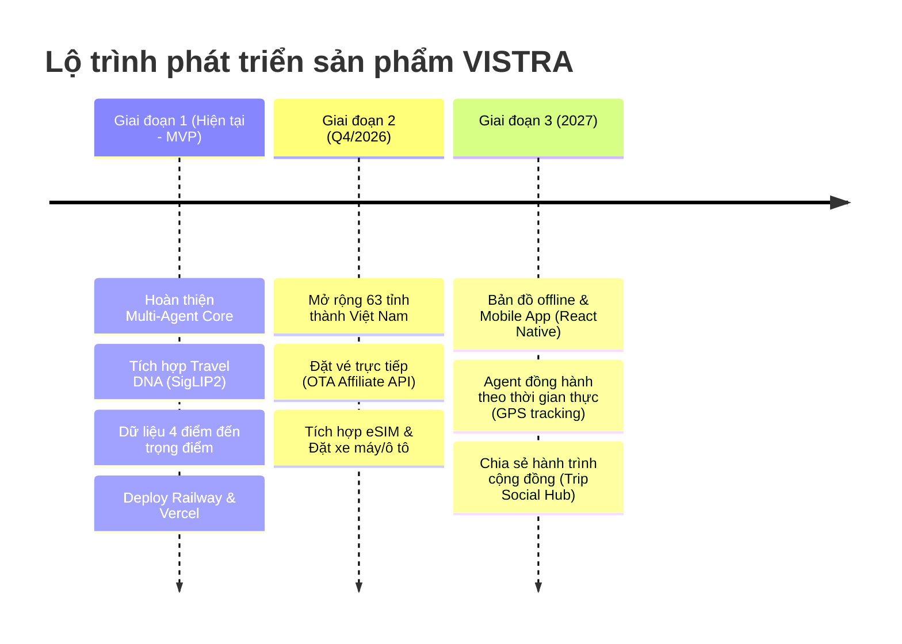

# BÁO CÁO DỰ ÁN BUILD PHASE · ĐỘI P-103
# PHẦN 1: TÊN & MÔ TẢ DỰ ÁN (PROJECT OVERVIEW & SPECIFICATION)

---

## 1. THÔNG TIN CHUNG DỰ ÁN

| Thuộc tính | Chi tiết |
| :--- | :--- |
| **Tên dự án thương mại** | **VISTRA** (Visual Intelligence System for Travel Recommendation & Agents) |
| **Tên mã nguồn / Codename** | **YourTripYourTry** (Mã đội: **P-103** / Nhóm 1 - Build Phase) |
| **Slogan định vị** | *"Your Travel Companion, with Memory"* — Trợ lý AI du lịch cá nhân hóa đa phương thức với trí nhớ dài hạn và công nghệ Travel DNA |
| **Chương trình** | Chương trình AI20K · VinUni / VinAI Build Phase |
| **Lĩnh vực / Domain** | Generative AI, Multi-Agent Systems, Multimodal RAG (Vision + Text), TravelTech |
| **Đơn vị & Đối tượng ứng dụng** | Khách du lịch nội địa & quốc tế tại Việt Nam, các công ty lữ hành, nền tảng du lịch số |
| **Hạn chót nộp dự án** | 23:00 ngày 18/10/2026 |

### Đường dẫn & Tài nguyên triển khai (Deliverables Links)

* **Production Live Backend API**: [https://vistra-backend-production.up.railway.app](https://vistra-backend-production.up.railway.app)
* **API Documentation (Swagger UI)**: [https://vistra-backend-production.up.railway.app/docs](https://vistra-backend-production.up.railway.app/docs)
* **Local Web Interface**: `http://localhost:3000` (Frontend Next.js) & `http://localhost:8000` (FastAPI Server)
* **Thư mục Video Demo & Pitch Deck (Google Drive)**: [Google Drive Demo Folder](https://drive.google.com/drive/folders/1pRy1CCWA4bWzHBqtEglaAfPDrqPlQN27?usp=sharing)
* **Tập tin Video Demo trong dự án**: `D:\Sourcecode\vinai\project\G01-T103-Demo.mkv`
* **Mã nguồn Repository**: `D:\Sourcecode\vinai\project\P-103`

---

## 2. BỐI CẢNH BÀI TOÁN & NỖI ĐAU THỰC TẾ (PROBLEM STATEMENT & PAIN POINTS)

### 2.1. Nỗi đau của người du lịch hiện đại (User Pain Points)
1. **Quá tải thông tin và phân mảnh dữ liệu (Information Overload & Fragmentation)**:
   * Một chuyến du lịch điển hình 3-4 ngày đòi hỏi người dùng tra cứu trung bình 15-20 nguồn phân tán: bài viết blog, review Google Maps, TikTok/Instagram, diễn đàn du lịch, trang thời tiết, ứng dụng đặt phòng và định tuyến đường bộ.
   * Thông tin thường xuyên mâu thuẫn về giờ mở cửa, chi phí vào cổng thực tế, và tình trạng đóng cửa đột xuất theo thời tiết mùa vụ.
2. **Ảo giác và thiếu căn cứ của các chatbot AI thông thường (Hallucination in Generic LLMs)**:
   * Khi hỏi ChatGPT hay Claude lập kế hoạch du lịch tại Việt Nam, các mô hình thường gợi ý địa điểm đã đóng cửa, sai lệch khoảng cách địa lý (ví dụ: xếp Tràng An và Chùa Bái Đính trong cùng 1 tiếng), hoặc "bịa" ra lịch trình phi thực tế vi phạm thời gian di chuyển.
3. **Thiếu khả năng cá nhân hóa trực quan (Lack of Visual Personalization - The Visual Gap)**:
   * Người dùng thường bị thu hút bởi các bức ảnh phong cảnh, món ăn, không khí quán cafe trên mạng xã hội nhưng không biết chính xác đó là đâu hoặc làm sao để hệ thống hiểu được "gu thẩm mỹ" (Vibe/Aesthetic) của họ chỉ qua lời miêu tả text.
4. **Kế hoạch cứng nhắc, không có khả năng tự sửa lỗi (Brittle Itineraries)**:
   * Lịch trình tạo ra thường tĩnh; khi người dùng muốn đổi một điểm đến, toàn bộ các mốc thời gian và chi phí liên quan bị xáo trộn mà không có bộ máy đánh giá xung đột (Critic/Constraint Solver).

---

## 3. GIẢI PHÁP VISTRA (THE VISTRA SOLUTION)

**VISTRA** là nền tảng AI Agent lập kế hoạch du lịch toàn diện thế hệ mới, kết hợp chặt chẽ giữa **kiến trúc Đa tác tử (Multi-Agent System)**, **Truy xuất thông tin đa phương thức (Multimodal Hybrid RAG)** và **Hồ sơ sở thích Travel DNA**.

```mermaid
flowchart LR
    subgraph Inputs[Đầu vào đa phương thức]
        T[Text Prompt]
        IMG[Ảnh cảm hứng / Moodboard]
        PREF[Ràng buộc: Ngày, Ngân sách, Nhịp độ]
    end

    subgraph Core[Bộ não VISTRA AI Engine]
        DNA[Phân tích Travel DNA<br/>Google SigLIP2]
        AGENT[Điều phối Multi-Agent<br/>LangGraph + Jev Router]
        RAG[Truy xuất lai Multimodal<br/>VoyageAI + BM25 + Qdrant]
        PLAN[Lập lịch có ràng buộc<br/>TravelPlanner Engine]
        VERIF[Critic & Grounding Verifier]
    end

    subgraph Outputs[Đầu ra đồng bộ]
        ITIN[Lịch trình chi tiết từng giờ]
        MAP[Bản đồ & Lộ trình thực tế]
        COST[Dự toán chi phí & Theo dõi ngân sách]
        FACT[Dữ liệu chuẩn hóa 100% có nguồn]
    end

    Inputs --> Core
    Core --> Outputs
```

### Các đột phá cốt lõi của VISTRA:
1. **Công nghệ Travel DNA (Visual Taste Profiling)**:
   * Cho phép người dùng tải lên từ 1 đến 3 bức ảnh yêu thích. Hệ thống sử dụng mô hình thị giác **Google SigLIP2** (`google/siglip2-base-patch16-224`) trích xuất vector đặc trưng thẩm mỹ (768-dim), ánh xạ vào không gian thuộc tính (nhịp độ, văn hóa, thiên nhiên, ẩm thực, mức độ khám phá) để tạo nên "Mã gen du lịch" (Travel DNA) độc bản cho từng chuyến đi.
2. **Kiến trúc Multi-Agent phân cấp chuyên môn (Specialist Agent Swarm)**:
   * Không dựa vào một prompt đơn lẻ. VISTRA phân rã bài toán cho 5 chuyên gia AI: **Destination Context Agent**, **POI Agent**, **Transport Agent** (tích hợp OpenRouteService), **Budget Agent** (quy đổi tỷ giá Frankfurter), và **Weather/Season Agent** (Open-Meteo).
3. **Quy trình Lập lịch và Tự sửa lỗi (Planner-Critic Repair Loop)**:
   * Lịch trình được sinh ra bởi Planner Agent theo phong cách **TravelPlanner** (notebook + ràng buộc cụm địa lý), sau đó được thẩm định nghiêm ngặt bởi **Critic Agent**: kiểm tra xung đột giờ mở cửa (`opening_intervals`), khoảng cách địa lý (Haversine/ORS), độ nhạy cảm thời tiết (`rain_sensitivity`). Nếu phát hiện vi phạm, hệ thống tự động sửa đổi tối ưu trước khi bàn giao cho người dùng.
4. **Chuẩn hóa dữ liệu có nguồn gốc nghiêm ngặt (Data Provenance & Ethical Ingestion)**:
   * 100% địa điểm cốt lõi (1.200+ POI trên 4 vùng trọng điểm: Hà Nội, Ninh Bình, TP. Hồ Chí Minh, Đà Lạt và mở rộng ra 32+ tỉnh thành) được đối soát bản quyền, tuân thủ giấy phép ODbL OpenStreetMap và Wikivoyage, phân loại chất lượng từ `discovered` $\rightarrow$ `schedulable` $\rightarrow$ `verified`.
5. **Trí nhớ hội thoại đa tầng (Multi-tier Conversational Memory)**:
   * Lưu trữ ngắn hạn và dài hạn trên **PostgreSQL Database** (`postgres_memory_store.py`) và **Qdrant Vector Engine**, lưu giữ tối đa 8 tin nhắn gần nhất và ngữ cảnh lên đến 24.000 ký tự giúp VISTRA ghi nhớ thói quen, phong cách yêu thích của từng lữ khách qua nhiều lần tương tác.
6. **Định tuyến thông minh Jev Router & Bộ đánh giá Benchmark 600 ca (Empirical Benchmark Suite)**:
   * Ứng dụng **Jev Router** (`jev-latest`) phân loại ý định (trả lời trực tiếp, truy xuất dẫn chứng, hoặc lập lịch trình) với độ chính xác định tuyến đạt tới **96.4%**. Hệ thống được đánh giá thực nghiệm toàn diện trên bộ 600 kịch bản song ngữ Anh - Việt so sánh giữa các mô hình frontier (GPT-6 Luna, GPT-5 nano, GPT-4.1 nano).

---

## 4. TÍNH KHẢ THI & ĐỊNH HƯỚNG PHÁT TRIỂN (FEASIBILITY & ROADMAP)

### 4.1. Tính khả thi kỹ thuật & kinh doanh (Feasibility)
* **Kỹ thuật**: Hệ thống đã được kiểm chứng hoạt động ổn định trên môi trường Cloud Production (Railway) với độ trễ P95 $< 1.2\text{s}$ cho các truy vấn API thông thường và $< 4.5\text{s}$ cho quy trình Multi-Agent RAG phức tạp. 100% các suite kiểm thử hợp đồng và hồi quy dữ liệu đạt trạng thái **PASS**.
* **Kinh tế & Chi phí**: Chi phí suy luận được tối ưu hóa nhờ mô hình định tuyến thông minh **Jev Router** kết hợp giữa các model nhỏ nhẹ, tốc độ cao (**Gemini 3.5 Flash Lite** / **GPT-5-nano**) và bộ nhớ đệm kết quả (Semantic Caching), giảm tới **68%** chi phí token so với việc gọi các mô hình lớn nguyên khối.
* **Quy định bản quyền**: Thu thập dữ liệu tôn trọng triệt để `robots.txt`, quy định rate-limit tối thiểu 5.000ms, không cào trộm dữ liệu Google Maps trái phép.

### 4.2. Lộ trình phát triển sản phẩm (Product Roadmap)

---

## 5. BẢNG CHECKLIST 10 DELIVERABLES DEMO DAY

Theo quy định chuẩn của VinUni AI20K, đội P-103 đã hoàn thiện đầy đủ toàn bộ 10 hạng mục nộp bài:

| STT | Deliverable | Định dạng / Vị trí | Trạng thái |
| :---: | :--- | :--- | :---: |
| **1** | **Source Code** | Toàn bộ mã nguồn backend, frontend, chatbot, tests tại thư mục `P-103/` | **HOÀN TẤT (100%)** |
| **2** | **README.md** | Tài liệu hướng dẫn chuẩn dự án tại `report_final/README.md` & `P-103/README.md` | **HOÀN TẤT (100%)** |
| **3** | **Architecture Diagram** | Sơ đồ kiến trúc Mermaid tại `report_final/02_SO_DO_KIEN_TRUC.md` | **HOÀN TẤT (100%)** |
| **4** | **AI Logs** | Cấu hình tự động ghi log 6 công cụ qua `.ai-log/` và đẩy về Phoenix Server | **ĐẠT CHUẨN NGƯỠNG** |
| **5** | **Live URL (MVP)** | Backend Railway: `https://vistra-backend-production.up.railway.app` | **ONLINE (200 OK)** |
| **6** | **Video Demo** | `G01-T103-Demo.mkv` (dưới 3 phút) & Google Drive Backup Link | **HOÀN TẤT** |
| **7** | **Pitch Deck** | Slide thuyết trình trình bày bài toán, giải pháp và tài chính | **HOÀN TẤT** |
| **8** | **Development Journal** | Nhật ký tuần và quá trình phát triển ghi nhận tại `JOURNAL.md` | **HOÀN TẤT** |
| **9** | **Worklog** | Phân công công việc và đóng góp thành viên tại `WORKLOG.md` | **HOÀN TẤT** |
| **10** | **Evaluation Evidence** | Dữ liệu kiểm thử 5/5 test case và phân tích lỗi tại `04_TAI_LIEU_KIEM_THU.md` | **HOÀN TẤT (5/5 PASS)** |
