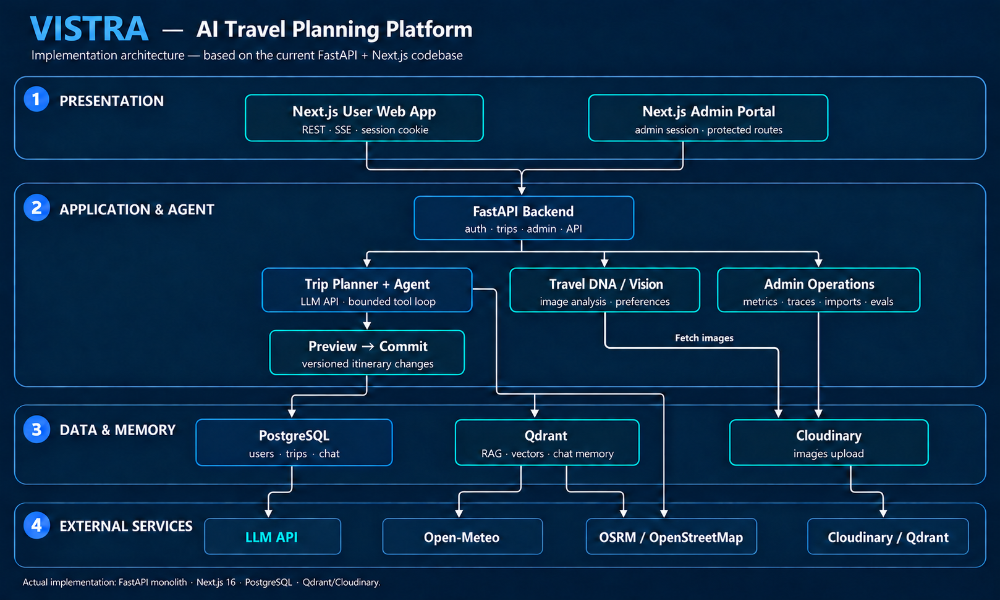
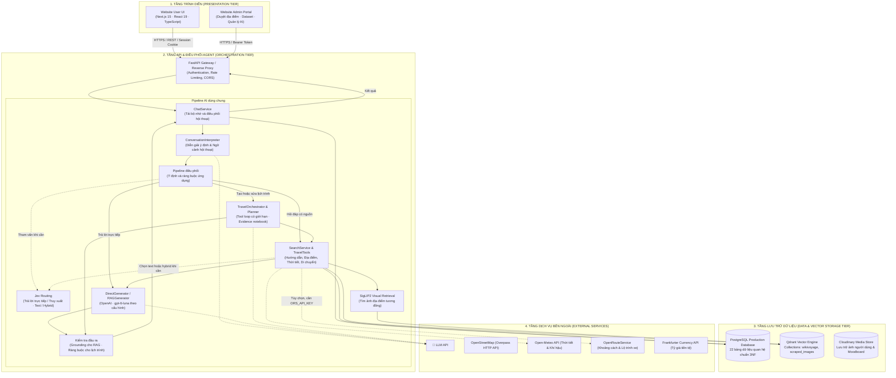
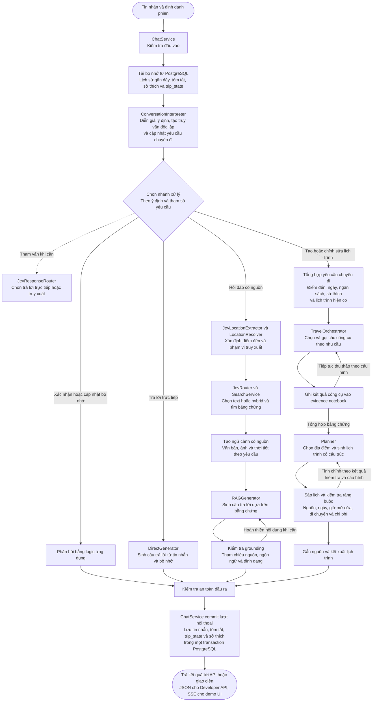
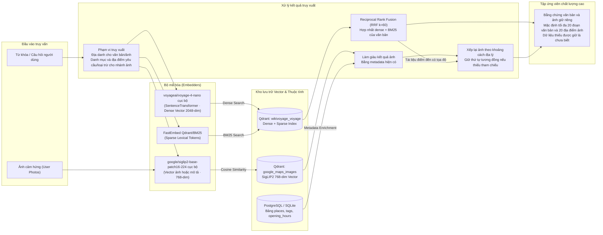
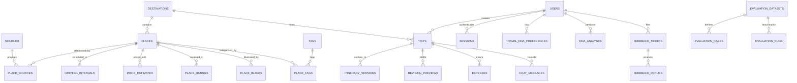
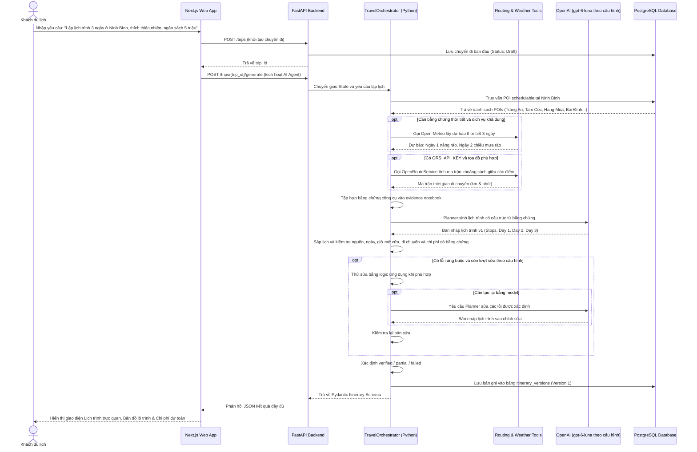
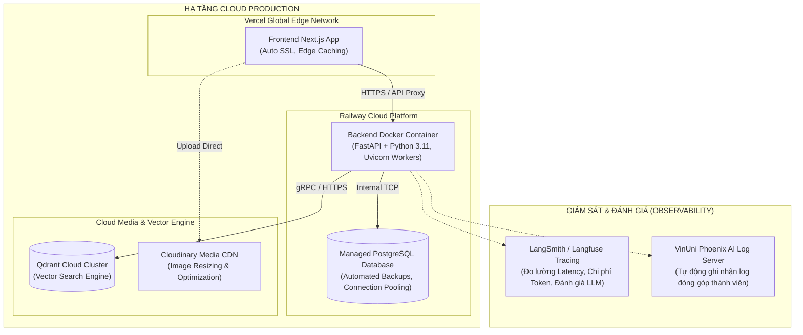

# BÁO CÁO DỰ ÁN CAPSTONE · ĐỘI P-103
# PHẦN 2: SƠ ĐỒ KIẾN TRÚC HỆ THỐNG (SYSTEM ARCHITECTURE DIAGRAMS)

---

## 1. TỔNG QUAN KIẾN TRÚC HỆ THỐNG (HIGH-LEVEL SYSTEM ARCHITECTURE)

Hệ thống **VISTRA** được thiết kế theo mô hình **Kiến trúc phân tầng hướng dịch vụ (Multi-tiered Service-Oriented Architecture)**, kết hợp giữa mô hình RESTful API hiện đại và pipeline AI hỗ trợ hội thoại có bộ nhớ, truy xuất đa phương thức và lập lịch trình bằng công cụ:



> **Phạm vi cập nhật:** Chỉ cập nhật thành phần AI theo mã nguồn VISTRA ngày 17/10/2026: diễn giải hội thoại, Jev routing, Voyage/BM25, SigLIP2, OpenAI và TravelOrchestrator. Kiến trúc frontend/backend, API, mô hình dữ liệu, dịch vụ hạ tầng và triển khai được giữ nguyên theo tài liệu gốc; các phần đó không được kiểm định lại trong lần cập nhật này.



---

## 2. PIPELINE HỘI THOẠI VÀ ĐIỀU PHỐI AI (AI ORCHESTRATION PIPELINE)

Pipeline hội thoại của VISTRA được điều phối bằng Python qua `ChatService`, `run_chat_pipeline()` và `run_pipeline()`. Mỗi lượt xử lý kết hợp tin nhắn hiện tại với bộ nhớ hội thoại để chọn cách phản hồi: xác nhận thông tin cá nhân, trả lời trực tiếp, hỏi đáp dựa trên nguồn hoặc tạo/chỉnh sửa lịch trình. Các bước diễn giải và sinh nội dung sử dụng OpenAI với model được cấu hình trong `config.yaml`, hiện tại là `gpt-6-luna`.



### 2.1. Nạp bộ nhớ và diễn giải hội thoại

`ChatService` tải lịch sử gần đây, tóm tắt phiên, sở thích dài hạn và trạng thái chuyến đi từ PostgreSQL. `ConversationInterpreter` dùng ngữ cảnh này để xác định ý định, diễn giải câu hỏi nối tiếp thành truy vấn độc lập và cập nhật thông tin như điểm đến, thời gian, ngân sách, sở thích hoặc ngày cần chỉnh sửa. Các yêu cầu xác nhận và cập nhật bộ nhớ có thể được phản hồi trực tiếp bằng logic ứng dụng.

### 2.2. Chọn cách trả lời và truy xuất bằng chứng

Pipeline chọn nhánh xử lý theo ý định hội thoại và các tham số yêu cầu. `JevResponseRouter` hỗ trợ quyết định giữa trả lời trực tiếp và truy xuất khi cần. Yêu cầu tạo hoặc chỉnh sửa lịch trình được nhận diện từ hội thoại và chuyển tới `TravelOrchestrator`.

| Nhánh | Xử lý chính |
|---|---|
| **Trả lời trực tiếp** | `DirectGenerator` tạo câu trả lời từ tin nhắn hiện tại và bộ nhớ hội thoại. |
| **Hỏi đáp có nguồn** | `JevLocationExtractor` và các bộ giải quyết địa danh xác định phạm vi. `JevRouter` hỗ trợ chọn `text` hoặc `hybrid`. `SearchService` thu thập bằng chứng, sau đó `RAGGenerator` sinh và kiểm tra câu trả lời. |
| **Tạo/chỉnh sửa lịch trình** | `TravelOrchestrator` kết hợp yêu cầu hiện tại, sở thích và lịch trình trước đó để thu thập bằng chứng, lập lịch và thực hiện chỉnh sửa theo phạm vi được yêu cầu. |

Nhánh `text` truy xuất Wikivoyage bằng dense embedding Voyage và BM25, hợp nhất thứ hạng bằng RRF. Nhánh `hybrid` thực hiện tìm kiếm văn bản và ảnh đồng thời, dùng SigLIP2 cho phần ảnh, bổ sung metadata và xếp lại ảnh theo khoảng cách đến tài liệu điểm đến phù hợp. Bằng chứng thời tiết từ Open-Meteo được bổ sung theo yêu cầu và cấu hình. `RAGGenerator` sử dụng ngữ cảnh có nguồn để soạn câu trả lời, kiểm tra grounding, ngôn ngữ cùng định dạng và hoàn thiện nội dung theo phản hồi kiểm tra.

### 2.3. Thu thập bằng chứng và lập lịch trình

`TravelOrchestrator` chuẩn hóa yêu cầu chuyến đi và điều phối các công cụ trong vòng lặp có kiểm soát. Planner lựa chọn công cụ theo bằng chứng đã có và các thông tin cần thu thập. Kết quả mỗi lần gọi được kiểm tra cấu trúc và ghi vào **evidence notebook**, tạo ngữ cảnh chung cho quá trình lập lịch.

| Công cụ | Vai trò trong pipeline |
|---|---|
| `GuideSearch` | Truy xuất hướng dẫn điểm đến và bằng chứng văn bản/ảnh theo nhánh được chọn. |
| `AttractionSearch` | Chọn địa điểm tham quan từ dữ liệu đã lập chỉ mục. |
| `RestaurantSearch` | Thu thập nhà hàng và thông tin liên quan cho các bữa ăn. |
| `AccommodationSearch` | Thu thập cơ sở lưu trú và các thuộc tính phục vụ lập lịch. |
| `WeatherSearch` | Bổ sung bằng chứng thời tiết cho ngày và địa điểm của chuyến đi. |
| `DistanceMatrix` | Thu thập khoảng cách và thời gian di chuyển qua OpenRouteService khi được cấu hình. |

Từ notebook, `Planner` sinh lịch trình có cấu trúc. Các module `scheduling` và `validation` sắp xếp hoạt động theo thời gian và kiểm tra danh tính nguồn, điểm đến, số ngày, giờ mở cửa, di chuyển, sự đa dạng địa điểm và chi phí có bằng chứng. Quá trình hoàn thiện kết hợp logic sắp lịch bằng Python với bước tinh chỉnh của Planner theo cấu hình. Khi chỉnh sửa theo ngày, pipeline giữ phạm vi chỉnh sửa gắn với yêu cầu hội thoại. Kết quả được gắn nguồn và kết xuất thành nội dung lịch trình.

### 2.4. Lưu trạng thái và trả kết quả

Sau khi kiểm tra đầu ra, `ChatService` lưu tin nhắn người dùng, câu trả lời, tóm tắt hội thoại, trạng thái chuyến đi và thay đổi sở thích trong một transaction PostgreSQL có quản lý version. Kết quả được chuyển tới lớp API/giao diện: Developer API trả JSON, còn demo UI sử dụng SSE để hiển thị nội dung và kết quả. Bộ nhớ đã lưu tiếp tục được sử dụng ở lượt hội thoại kế tiếp.

---

## 3. KIẾN TRÚC TRUY XUẤT THÔNG TIN LAI (MULTIMODAL HYBRID RAG)

VISTRA sử dụng **Multimodal Hybrid Retrieval Pipeline** để cung cấp bằng chứng văn bản và hình ảnh cho câu trả lời. Nhánh văn bản hợp nhất dense search và BM25 bằng RRF (`k=60`); nhánh ảnh dùng SigLIP2 để tìm bằng mô tả hoặc ảnh tham chiếu. Trong chế độ `hybrid`, hai nhánh tìm kiếm chạy đồng thời, giữ kết quả riêng và xếp lại ảnh theo khoảng cách tới tài liệu điểm đến phù hợp có tọa độ. Cơ chế này giúp giảm phát biểu thiếu căn cứ, không bảo đảm loại bỏ hoàn toàn sai lệch.



---

## 4. QUY TRÌNH TRUY XUẤT THỊ GIÁC CỦA THÀNH PHẦN AI

Thành phần AI hiện tại dùng SigLIP2 để mã hóa ảnh tham chiếu và tìm ảnh địa điểm tương đồng. AI không chiếu vector thành 12 chiều Travel DNA, không sinh hồ sơ DNA hay trọng số phong cách đã xác nhận. Sở thích và yêu cầu chuyến đi được diễn giải từ hội thoại.

Trong sơ đồ dưới đây, các thao tác frontend/backend, endpoint, trường JSON và bảng dữ liệu được giữ nguyên theo hợp đồng kiến trúc gốc. Các tên `dna/analyze`, `dna_analyses`, `suggested_dna` và thanh trượt DNA thuộc phần được giữ nguyên đó, không phải chức năng được xác nhận của AI hiện tại. Kết quả AI được mô tả trong phạm vi truy xuất ảnh và cần được phân biệt với hợp đồng backend này.

```mermaid
sequenceDiagram
    autonumber
    actor User as Người dùng
    participant FE as Frontend Composer
    participant BE as FastAPI Backend
    participant SigLIP as SigLIP2 Vision Model
    participant Retrieval as Image Retrieval Pipeline
    participant Qdrant as Qdrant Image Search
    participant DB as Database (Postgres)

    User->>FE: Chọn hoặc Paste 1-3 ảnh vào Composer
    FE->>FE: Kiểm tra kích thước (< 5MB) và định dạng (JPEG/PNG/WebP)
    FE->>BE: POST /api/v1/dna/analyze (kèm danh sách URL ảnh Cloudinary)
    BE->>BE: Xác thực Session và kiểm tra tính toàn vẹn của ảnh
    BE->>SigLIP: Trích xuất Vector đặc trưng hình ảnh (768-dim)
    SigLIP-->>Retrieval: Trả về vector ảnh 768 chiều
    Retrieval->>Qdrant: Tìm ảnh tương đồng trong phạm vi truy vấn
    Qdrant-->>Retrieval: Các nhóm ảnh địa điểm và điểm tương đồng
    Retrieval->>Retrieval: Làm giàu metadata; trong hybrid, xếp ảnh theo khoảng cách khi có tham chiếu
    Retrieval-->>BE: Kết quả địa điểm tương đồng và bằng chứng ảnh
    BE->>DB: Lưu bản ghi tạm vào bảng dna_analyses (Hết hạn sau 24h)
    BE-->>FE: Trả kết quả JSON (metrics, suggested_dna, analysis_id)
    FE-->>User: Hiển thị các thanh trượt Travel DNA đã được điều chỉnh tự động
    User->>FE: Người dùng tùy chỉnh tinh chỉnh thêm (nếu muốn) và bấm "Tạo chuyến đi"
    FE->>BE: POST /api/v1/trips (gửi kèm trip_data + analysis_id + DNA cuối cùng)
    BE->>DB: Gắn kết Travel DNA vào chuyến đi trong bảng trips
```

---

## 5. MÔ HÌNH THỰC THỂ DỮ LIỆU ĐA TẦNG (DATA DOMAIN ENTITY RELATIONSHIP)

Hệ thống dữ liệu VISTRA bao gồm 22 bảng được tổ chức thành 6 nhóm nghiệp vụ chính:



---

## 6. SƠ ĐỒ ĐIỀU PHỐI ĐẦU CUỐI (END-TO-END SEQUENCE DIAGRAM)

Quy trình hoàn chỉnh từ lúc người dùng yêu cầu tạo lịch trình đến khi nhận được kế hoạch chi tiết. Sơ đồ giữ nguyên hợp đồng API và lưu trữ của backend gốc, minh họa trường hợp AI trả được lịch trình. AI hiện tại có thể trả `partial` khi còn dữ liệu chưa biết hoặc `failed` khi bản nháp không vượt qua kiểm tra; trạng thái `failed` không cung cấp lịch trình hợp lệ. `verified` chỉ xác nhận các kiểm tra được triển khai trên bằng chứng đã thu thập, không bảo đảm toàn bộ thông tin thực tế đều đầy đủ và cập nhật:



---

## 7. KIẾN TRÚC TRIỂN KHAI VÀ HẠ TẦNG (DEPLOYMENT & INFRASTRUCTURE)

Hệ thống hỗ trợ 2 môi trường vận hành độc lập: **Môi trường phát triển cục bộ (Local Docker)** và **Môi trường đám mây Production (Railway & Vercel)**:



---

## 8. NGUYÊN TẮC BẢO MẬT & ĐẢM BẢO CHẤT LƯỢNG (SECURITY & SAFETY PRINCIPLES)

1. **Bảo vệ khóa bí mật (Secrets Management)**:
   * Toàn bộ API Key (Gemini, OpenAI, Qdrant, Cloudinary) được lưu trữ trong biến môi trường hệ thống, tuyệt đối không commit vào kho mã nguồn Git.
2. **Xác thực phiên an toàn (Secure Session Authentication)**:
   * Cookie xác thực `vistra_session` được gán cờ `HttpOnly`, `SameSite=Lax` và `Secure` trên môi trường Production để ngăn chặn hoàn toàn tấn công XSS và đánh cắp token.
3. **Kiểm tra dữ liệu nghiêm ngặt (Strict Schema Validation)**:
   * 100% dữ liệu đầu vào và đầu ra được thẩm định qua các lớp mô hình Pydantic v2 với cờ `extra="forbid"`, loại bỏ nguy cơ Parameter Tampering hoặc Injection.
4. **Chuẩn hóa Cơ sở dữ liệu PostgreSQL & Qdrant (Database Standardization)**:
   * Hệ thống vận hành hoàn toàn trên nền tảng **PostgreSQL** với 22 bảng dữ liệu quan hệ chuẩn 3NF và **Qdrant Vector Engine** phục vụ tìm kiếm ngữ nghĩa, đảm bảo tính toàn vẹn khóa ngoại, hiệu năng truy vấn cao và khả năng mở rộng quy mô sản xuất.
