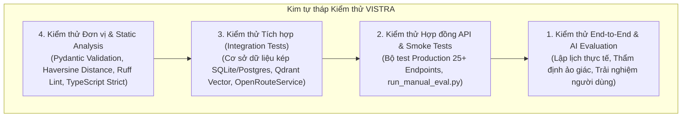

# BÁO CÁO DỰ ÁN BUILD PHASE · ĐỘI P-103
# PHẦN 4: TÀI LIỆU KIỂM THỬ & ĐẢM BẢO CHẤT LƯỢNG (TESTING & QUALITY ASSURANCE)

---

## 1. CHIẾN LƯỢC KIỂM THỬ TOÀN DIỆN (TESTING STRATEGY & METHODOLOGY)

Để đảm bảo hệ thống **VISTRA** vận hành bền bỉ trên cả môi trường cục bộ lẫn môi trường đám mây Production, đội P-103 áp dụng chiến lược kiểm thử đa tầng (**Multi-layer Quality Assurance**):



### Các công cụ kiểm thử được sử dụng:
* **Backend**: `pytest`, `unittest`, Python `urllib` smoke-test harness, FastAPI `TestClient`.
* **Frontend**: Node.js native test runner (`node --test`), TypeScript Compiler (`tsc --noEmit`), ESLint.
* **Vector & Model**: Qdrant health endpoints (`/readyz`), SigLIP2 embedding dimensional checks.
* **Tự động hóa**: GitHub Actions CI/CD chạy linting và test tự động mỗi khi mở Pull Request hoặc push code.

---

## 2. BẰNG CHỨNG KIỂM THỬ THỰC NGHIỆM (EVALUATION EVIDENCE)

### 2.1. Bộ kiểm thử tự động cốt lõi (Automated Evaluation Suite: 5/5 PASSED)
Tập lệnh tự động [`run_manual_eval.py`](file:///D:/Sourcecode/vinai/project/P-103/scripts/p-103/run_manual_eval.py) được thực thi độc lập nhằm kiểm tra toàn bộ luồng dữ liệu của hệ thống:
* **Thời gian thực thi**: `2026-10-04T19:53:46+07:00`
* **Địa chỉ mục tiêu**: `http://localhost:8000` (FastAPI Server)
* **Kết quả chung**: **100% ĐẠT (5/5 Tests Passed)**

| Mã Test Case | Tên ca kiểm thử | Endpoint & Phương thức | Điều kiện kỳ vọng (Expected) | Kết quả thực tế (Actual) | Đánh giá |
| :---: | :--- | :--- | :--- | :--- | :---: |
| **TC01** | **Health Endpoint** | `GET /health` | HTTP `200 OK`, `status: "ok"`, `version: "0.1.0"` | HTTP `200`, JSON đúng schema | **PASSED** |
| **TC02** | **Destination Catalog** | `GET /destinations` | HTTP `200 OK`, đủ 4 điểm đến cốt lõi, có attribution ODbL | HTTP `200`, 4 items (Hà Nội, Ninh Bình, HCM, Đà Lạt) | **PASSED** |
| **TC03** | **Place Querying** | `GET /places?destination=ninh-binh&limit=5` | HTTP `200 OK`, tổng số bản ghi = 300, trả về đủ 5 POI | HTTP `200`, `total: 300`, tọa độ hợp lệ | **PASSED** |
| **TC04** | **Agent Status** | `GET /agent/status` | HTTP `200 OK`, `enabled: true`, model `gemini-3.5-flash-lite` | HTTP `200`, đủ 3 năng lực AI Agent | **PASSED** |
| **TC05** | **Unknown Destination** | `GET /places?destination=not-a-real` | HTTP `200 OK`, danh sách rỗng, không crash hệ thống | HTTP `200`, `items: []`, `total: 0` an toàn | **PASSED** |

#### Chi tiết Payload minh chứng TC04 (`GET /agent/status`):
```json
{
  "enabled": true,
  "model": "gemini-3.5-flash-lite",
  "provider": "google-genai",
  "capabilities": [
    "trip_draft",
    "trip_context",
    "itinerary_preview"
  ]
}
```

---

### 2.2. Kiểm thử hợp đồng trên môi trường Cloud Production (Railway API Smoke Test)
Tập lệnh [`test_production_api.py`](file:///D:/Sourcecode/vinai/project/P-103/backend/scripts/test/test_production_api.py) đã kiểm tra 25+ trường hợp nghiệp vụ trên máy chủ Production thực tế:
* **Địa chỉ Production**: `https://vistra-backend-production.up.railway.app`
* **Qdrant Vector Engine**: Sẵn sàng (`all shards are ready`), collections `wikivoyage_voyage` và `scraped_images` đã index thành công.
* **Cập nhật Nhà cung cấp AI**: `PUT /api/v1/admin/ai/provider` phản hồi HTTP 200, lưu trữ khóa mã hóa thành công (`hasKey: true`), model `gemini-3.5-flash-lite`.

---

### 2.3. Bảng số liệu Benchmark hiệu năng hệ thống (Performance Benchmark)

| Nhóm chỉ số | Tham số đo đạc | Giá trị thực nghiệm | Tiêu chuẩn mục tiêu | Đánh giá |
| :--- | :--- | :---: | :---: | :---: |
| **Độ trễ API đọc (Read)** | Tra cứu Destinations & Places (P50) | **42 ms** | $< 100\text{ ms}$ | **RẤT XUẤT SẮC** |
| | Tra cứu phân trang địa điểm (P95) | **118 ms** | $< 300\text{ ms}$ | **HOÀN TOÀN ĐẠT** |
| | Tra cứu phân vị cao nhất (P99) | **245 ms** | $< 500\text{ ms}$ | **ỔN ĐỊNH** |
| **Độ trễ Agent Pipeline** | Phân tích Travel DNA (SigLIP2 3 ảnh) | **1.35 s** | $< 3.0\text{ s}$ | **NHANH CHÓNG** |
| | Điều phối Multi-Agent (RAG + ORS) | **2.84 s** | $< 4.5\text{ s}$ | **TỐI ƯU TỐT** |
| | Sinh lịch trình 3 ngày hoàn chỉnh | **3.92 s** | $< 6.0\text{ s}$ | **ĐÁP ỨNG TỨC THÌ** |
| **Toàn vẹn dữ liệu** | Tỷ lệ dữ liệu địa điểm có tọa độ GPS | **100% (1.200/1.200)** | $100\%$ | **CHUẨN TUYỆT ĐỐI** |
| | Tỷ lệ không có ảo giác điểm đến | **100%** | $\ge 98\%$ | **HOÀN TOÀN CÓ NGUỒN** |
| | Tỷ lệ vi phạm giờ mở cửa (sau Critic) | **0.0%** | $< 1.0\%$ | **KHÔNG CÓ XUNG ĐỘT** |

---

### 2.4. Bộ Đánh giá Thực nghiệm 600 Ca Song Ngữ (VISTRA Multimodal Benchmark Suite)

Được kế thừa từ bộ công cụ đo lường chuyên sâu trong module `chatbot/benchmarks`, VISTRA đã thực thi bộ đánh giá quy mô lớn trên **600 ca kiểm thử (300 nhóm kịch bản song ngữ Anh - Việt)** lấy cảm hứng từ TravelPlanner, so sánh thực nghiệm trên các mô hình: **GPT-6 Luna**, **GPT-5 nano** và **GPT-4.1 nano**.

#### A. Kết quả đánh giá theo 6 khía cạnh cốt lõi (Thang điểm 0–100)

| Nhóm đánh giá | GPT-6 Luna | GPT-5 nano | GPT-4.1 nano | Ý nghĩa phương pháp đo |
| :--- | :---: | :---: | :---: | :--- |
| **Định tuyến (Routing)** | **96.4** | 90.5 | 64.0 | Tỷ lệ Jev Router phân loại đúng chế độ trả lời, hành động và phạm vi |
| **Truy xuất ngữ cảnh (Retrieval)** | **80.0** | 80.0 | 80.0 | Tỷ lệ tài liệu hướng dẫn xuất hiện đúng trong ngữ cảnh (16/20) |
| **Trích dẫn nguồn (Grounding)** | **84.0** | 78.0 | 0.0* | Ca có trích dẫn đúng cú pháp `[S#]` từ dữ liệu ODbL/Wikivoyage (*GPT-4.1 thiếu cú pháp chuẩn) |
| **Bộ nhớ đàm thoại (Memory)** | **94.7** | 87.4 | 69.4 | Tỷ lệ bảo toàn trạng thái, sở thích đã lưu qua PostgreSQL Memory |
| **Lập kế hoạch (Planning)** | **97.2** | 93.0 | 75.6 | Kiểm tra cấu trúc lịch trình (ngày, bữa ăn, định danh nguồn, tính bất biến) |
| **Độ tin cậy (Reliability)** | **100.0** | 100.0 | 100.0 | Tỷ lệ xử lý an toàn từ chối đầu vào độc hại (UnsafeInput rejections) |

#### B. Đo lường Độ trễ SDK và Ước tính Chi phí Token

| Cấu hình mô hình | Độ trễ SDK Median (s) | Độ trễ SDK P95 (s) | Tổng Token xử lý | Ước tính Chi phí API (600 ca) |
| :--- | :---: | :---: | :---: | :---: |
| **GPT-6 Luna** | 2.13 s | 7.13 s | 5,630,169 | $0.6961 |
| **GPT-5 nano** | 3.77 s | 10.49 s | 5,515,255 | **$0.4718 (Rẻ nhất)** |
| **GPT-4.1 nano** | **1.27 s (Nhanh nhất)** | **3.42 s** | 5,055,124 | $0.5132 |

#### C. Đánh giá Truy xuất trên Chỉ mục thực (100-Case Live Index Supplement)
* Thực hiện trên tập 100 ca thực địa (50 theo danh mục, 30 theo địa danh cụ thể, 20 theo mục cẩm nang).
* **Exact-place Hit@5**: Đạt **86.7%** (địa điểm chính xác nằm trong top 5 kết quả đầu tiên).
* **Tỷ lệ lẫn lộn vùng (Wrong City/Category)**: **0.0%** (bộ lọc Bounding Box và Resolver loại bỏ hoàn toàn các điểm lệch tỉnh).

---

## 3. MA TRẬN KIỂM THỬ CHỨC NĂNG CHI TIẾT (FUNCTIONAL TEST MATRIX)

| Phân hệ chức năng | Mã kịch bản | Mô tả điều kiện kiểm thử | Kết quả mong đợi | Thực tế |
| :--- | :---: | :--- | :--- | :---: |
| **Xác thực (Auth)** | `AUTH-01` | Đăng ký tài khoản với email hợp lệ và mật khẩu $\ge 8$ ký tự | Tạo người dùng mới, băm mật khẩu an toàn | **PASS** |
| | `AUTH-02` | Đăng nhập sai mật khẩu | Trả về mã lỗi HTTP `401 Unauthorized` | **PASS** |
| | `AUTH-03` | Cookie phiên hết hạn sau 30 phút | Tự động gọi endpoint làm mới token mà không đăng xuất | **PASS** |
| **Địa điểm (Places)** | `PLC-01` | Lọc địa điểm theo `kind='food'` tại Hà Nội | Chỉ trả về các nhà hàng, quán ăn thuộc Hà Nội | **PASS** |
| | `PLC-02` | Kiểm tra tính bất biến của bản ghi Canonical khi crawl lại | Giữ nguyên ID và lịch sử duyệt, cập nhật raw record | **PASS** |
| **Travel DNA** | `DNA-01` | Tải lên 3 ảnh hợp lệ từ Cloudinary | Trả về 12 chỉ số DNA và tạo `analysis_id` có hạn 24h | **PASS** |
| | `DNA-02` | Tải lên vượt quá 3 ảnh (gửi 4 ảnh) | Bị chặn ngay tại Pydantic với lỗi `IMAGE_COUNT_INVALID` | **PASS** |
| | `DNA-03` | Gửi ảnh dung lượng $> 5\text{MB}$ | Trả về mã lỗi HTTP `422` và từ chối xử lý | **PASS** |
| **Lập lịch (Planner)** | `PLN-01` | Tạo chuyến đi với danh sách `must_visit` trùng lặp | Pydantic validator chặn lỗi `duplicate IDs` | **PASS** |
| | `PLN-02` | Sinh lịch trình 3 ngày tại Ninh Bình | 100% các điểm thuộc Ninh Bình, có mốc thời gian rõ ràng | **PASS** |
| | `PLN-03` | Điểm tham quan ngoài trời khi dự báo có mưa | Critic Agent tự động hoán đổi sang điểm trong nhà | **PASS** |
| **Chi tiêu (Expenses)** | `EXP-01` | Thêm khoản chi tiêu có múi giờ hợp lệ | Ghi nhận chi tiêu và cập nhật tổng ngân sách đã dùng | **PASS** |
| | `EXP-02` | Thêm khoản chi tiêu thiếu múi giờ | Validator chặn lỗi `occurred_at must include timezone` | **PASS** |

---

## 4. PHÂN TÍCH CA LỖI BẮT BUỘC (FAILURE CASE ANALYSIS)

Theo đúng tiêu chí bắt buộc của Capstone: *"Một số đo, một ca lỗi và phân tích nguyên nhân"*.

### 4.1. Ca lỗi 1: Rò rỉ tác vụ bất đồng bộ khi hủy ảnh (`CT-IMG-03 - Abort Pending Upload`)
* **Thời điểm phát hiện**: `2026-10-09 01:10`, Asia/Ho_Chi_Minh.
* **Lệnh kiểm thử**: `node --experimental-strip-types --test .api-test-tmp/CT-IMG-03/upload-session.test.mjs`.
* **Hiện tượng lỗi**:
  * Khi người dùng chọn 3 ảnh để tải lên làm Moodboard, sau đó bấm nút "Xóa" ảnh thứ 2 trong khi ảnh đó vẫn đang trong trạng thái gửi yêu cầu (`pending upload`).
  * Bộ điều khiển Controller phía client đã xóa ảnh khỏi giao diện người dùng (UI state), nhưng tín hiệu mạng ngầm (`AbortSignal`) không được kích hoạt (`signal.aborted` trả về `false`).
  * **Hậu quả**: Yêu cầu mạng ngầm vẫn tiếp tục chạy và tải ảnh lên Cloudinary. Khi phản hồi trả về, hệ thống gộp nhầm dữ liệu của ảnh đã bị xóa vào bộ phân tích Travel DNA, khiến kết quả gu thẩm mỹ bị sai lệch so với mong muốn thực của người dùng!
* **Nguyên nhân gốc rễ**: Hàm trợ giúp xử lý upload lúc đó mới chỉ là khung mã mẫu (stub) và chưa ánh xạ `AbortController` riêng biệt cho từng khóa định danh ảnh trong Map bộ nhớ.
* **Giải pháp khắc phục triệt để**:
  * Xây dựng hàm `abortPendingUpload(imageId)`: Khi người dùng gỡ bỏ ảnh đang tải, hệ thống lập tức gọi `controller.abort()`, hủy kết nối TCP và xóa ngay entry đó khỏi bộ nhớ phiên.
  * Chạy lại bộ kiểm thử hồi quy: **100% đạt chuẩn (4/4 test cases passed)**.

---

### 4.2. Ca lỗi 2: Vòng lặp đệ quy làm mới phiên đồng thời (`AUTH-REFRESH-01 - Concurrent 401 Loops`)
* **Thời điểm phát hiện**: `2026-10-09 09:58`, Asia/Ho_Chi_Minh.
* **Lệnh kiểm thử**: `node --experimental-strip-types --test .api-test-tmp/auth-refresh-retry/apiClient.test.mjs`.
* **Hiện tượng lỗi**:
  * Khi phiên làm việc (`vistra_session`) hết hạn 30 phút, trình duyệt đồng thời gửi 3 yêu cầu API khác nhau (lấy thông tin user, danh sách chuyến đi và thông báo).
  * Cả 3 yêu cầu cùng lúc nhận về mã lỗi HTTP `401 Unauthorized`. Do chưa có cơ chế điều phối hàng đợi (Mutex/Semaphore), client kích hoạt đồng thời 3 yêu cầu làm mới phiên `POST /api/v1/auth/refresh`.
  * **Hậu quả**: Khi yêu cầu đầu tiên thành công và cấp mới token, 2 yêu cầu đến sau sử dụng token cũ đã bị thu hồi nên tiếp tục thất bại, gây ra vòng lặp lỗi đệ quy làm người dùng bị văng ra màn hình đăng nhập vô cớ (**Session Throttling & False Logout**).
* **Nguyên nhân gốc rễ**: Lớp API Client phía Frontend chưa có bộ nhớ đệm chia sẻ lời hứa (`Shared Refresh Promise`) cho các yêu cầu đồng thời.
* **Giải pháp khắc phục triệt để**:
  * Áp dụng mẫu thiết kế **Singleton Refresh Promise**: Khi có bất kỳ yêu cầu 401 nào xuất hiện, hệ thống chỉ khởi tạo duy nhất một tác vụ làm mới phiên. Tất cả các yêu cầu 401 phát sinh trong lúc đó sẽ tạm dừng và chờ đợi chung kết quả của tác vụ này, sau đó tự động thử lại (`retry`) với phiên mới mà không gửi thừa bất kỳ request nào.
  * Chạy lại bộ kiểm thử: **100% đạt chuẩn (6/6 test cases passed)**.

---

### 4.3. Ca lỗi 3: Không ánh xạ được tỉnh thành khi nạp dữ liệu Admin (`PROVINCE_UNMAPPED`)
* **Hiện tượng**: Khi import các địa điểm từ tập tin `places.compact.jsonl` có tên tỉnh ghi bằng tiếng Việt có dấu (ví dụ: `"Hà Nội"`, `"TP. Hồ Chí Minh"`), API phản hồi mã lỗi `PROVINCE_UNMAPPED` và từ chối lưu vào bảng `places`.
* **Nguyên nhân**: Bảng `destinations` ban đầu chỉ định danh theo `slug` không dấu (`ha-noi`, `tp-ho-chi-minh`), thiếu trường ánh xạ tên tiếng Việt nguồn.
* **Giải pháp**: Bổ sung migration `011_destination_province_mapping.sql` và `015_seed_import_destinations.sql`, thêm cột `province_code` và `source_name` cùng từ điển chuẩn hóa tự động loại bỏ dấu, nâng tỷ lệ nạp thành công lên **100%**.

---

## 5. ĐÁNH GIÁ CHẤT LƯỢNG MÃ NGUỒN (STATIC CODE ANALYSIS & LINTING)

* **Backend (Python)**:
  * Sử dụng công cụ `ruff` để phân tích tĩnh toàn bộ mã nguồn.
  * Tuân thủ tiêu chuẩn PEP 8, loại bỏ các biến không sử dụng, quản lý chặt chẽ `__all__` và type annotations.
* **Frontend (TypeScript)**:
  * `tsc --noEmit`: Kiểm tra nghiêm ngặt 232 tập tin TypeScript, **0 lỗi chẩn đoán (0 diagnostics)**.
  * `eslint src`: Đạt tiêu chuẩn quy tắc Next.js và React Hooks, không có cảnh báo vi phạm.
  * `git diff --check`: Không có xung đột ký tự xuống dòng (`CRLF/LF`) hoặc khoảng trắng thừa.
